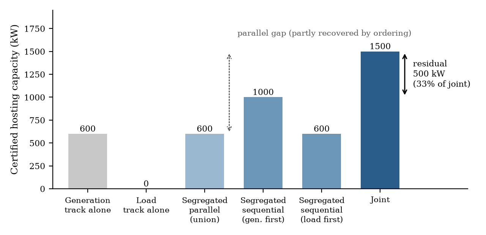
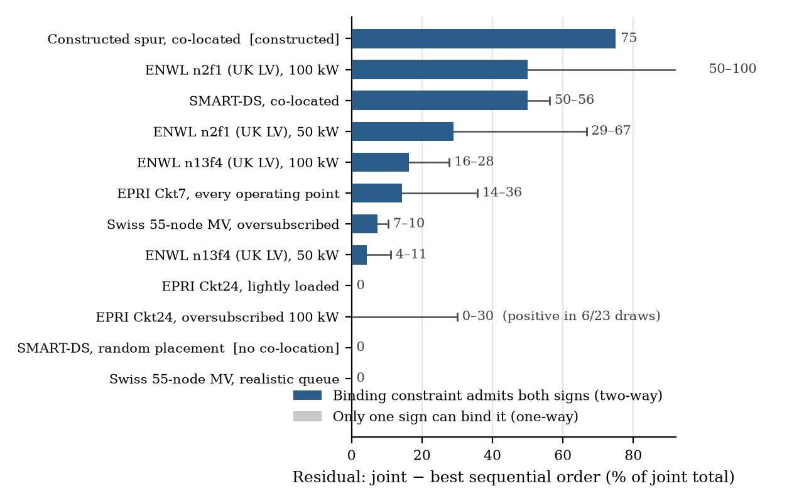
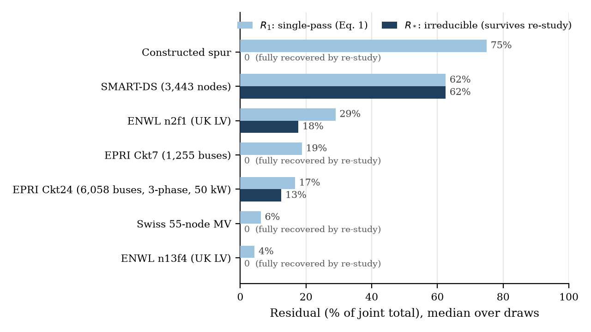
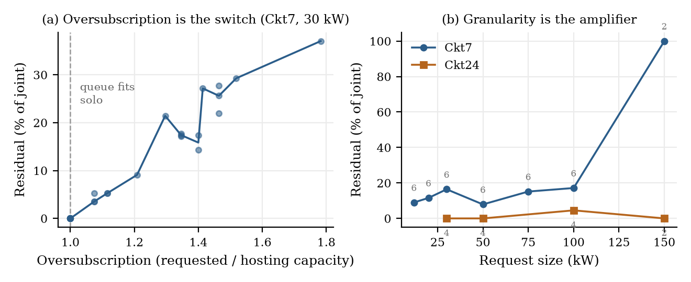
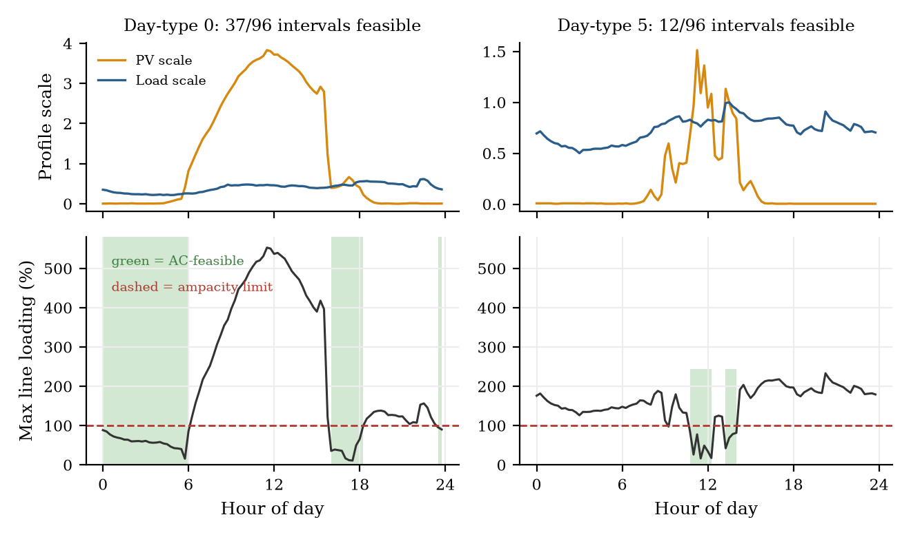

# Complements in the Queue: What Re-Studying Recovers, and What Only a Joint Interconnection Study Can

**Hugo Farajallah** — Independent Research — <research@hugofara.net>
ORCID [0009-0001-0769-4434](https://orcid.org/0009-0001-0769-4434)

> **This file is generated.** It is a reading copy of the submission manuscript,
> converted from [`latex/complements-in-the-queue.tex`](latex/complements-in-the-queue.tex)
> by `tools/build_paper_markdown.py`. Edit the LaTeX, not this file. The typeset
> PDF is [`latex/complements-in-the-queue.pdf`](latex/complements-in-the-queue.pdf);
> where the two disagree, the PDF is authoritative.
>
> Unrefereed preprint. Several power-flow-modelling correctness claims are
> load-bearing and are flagged in Section 7 as not independently verified by the
> author. The per-feeder laboratory notebooks are in [`../logs/`](../logs/); the
> internal hardening record — retractions, dead ends, the reviewer-style
> back-and-forth this draft was built against — is not part of this archive.
> How to run any of the code is in [`../../REPLICATION.md`](../../REPLICATION.md).

**Keywords:** interconnection queues · hosting capacity · co-located generation and load · distribution power flow · interconnection study process · complementarity

## Abstract

Utilities study generation and load interconnection requests in separate tracks, on different tariffs. Regulators in the EU, US, Ireland and Alberta now require the opposite, without quantifying what separation costs. That number splits in two. The *single-pass residual* is joint hosting capacity minus the better sequential study order; the *irreducible residual* is joint capacity minus the fixed point of unboundedly many alternating re-study rounds, a process that stays segregated and needs no reform. Only the second can justify merging tariff tracks, and across five feeder families they come apart sharply. Single-pass residuals reach a median 62.5% of joint on co-located SMART-DS, yet on most families re-studying recovers essentially all of it. What survives sits at one point of common coupling: a generation and a load request blocking each other on a constraint no approval elsewhere can relieve. That configuration is neither necessary nor sufficient; the relief decides, and we measure it, enumerating by exact power flow every base case a segregated process could build outside a certified pair: on SMART-DS, 12,500 reachable base cases, none seating either half. On EPRI Ckt24 at 50 kW the irreducible residual is 12.5% of joint, positive in 7 of 10 draws, certified by explicit pairs jointly feasible while neither half is. Its magnitude is conditional: splitting each request in two at the same site takes the median to zero, and across a shipped year it holds only while the site holds its net exchange. Feeder-wide complementarity can be handled by re-study alone.

## Nomenclature

|  |  |
|:---|:---|
| $`\mathcal{K}`$, $`\mathcal{G}`$, $`\mathcal{L}`$ | Request queue; its generation and load tracks |
| $`\mathcal{B}`$ | Base case: the feeder plus all previously approved requests |
| $`p_i`$, $`x_i`$ | Request $`i`$’s injection (signed) and its binary approval |
| $`\mathrm{HC}(\mathcal{Q};\mathcal{B})`$ | Hosting capacity of queue $`\mathcal{Q}`$ against base case $`\mathcal{B}`$, Eq. [eq:hc] |
| $`S^{\ast}(\mathcal{Q};\mathcal{B})`$ | The accept-set attaining it |
| $`S_k`$, $`T_k`$ | Approvals after alternating round $`k`$; the track studied in that round |
| $`R_{1}`$ | Single-pass residual: joint capacity minus the better sequential order |
| $`R_{\ast}`$ | Irreducible residual: joint capacity minus the alternating fixed point |
| $`g_c(x)`$ | Margin on constraint $`c`$; *private* to $`P`$ when it depends on $`x`$ only through $`P`$ |
| $`v_n`$, $`\ell_e`$ | Bus voltage magnitude; branch loading |
| $`\underline{v}`$, $`\overline{v}`$, $`\overline{\ell}`$ | Feasibility limits after the non-worsening rule, Eq. [eq:nonworsening] |
| $`A_v`$, $`A_t`$ | GLDF sensitivities of bus voltage-squared and branch flow to requests |
| $`M`$ | Voltage-sensitivity matrix of the linearized model |
| $`\sigma_c(i)`$ | Relief ratio screening request $`i`$ on constraint $`c`$, Eq. [eq:relief] |
| $`w`$ | Comparison weight on generation kW |
| $`\rho`$ | Battery rating as a multiple of a co-requesting site’s array |
| GLDF | Generalized LinDistFlow |
| QSTS | Quasi-static time series |

## 1. Introduction

A distribution utility receives interconnection requests for PV arrays, batteries, EV-charging depots and data centers. By convention each is assigned to one of two study tracks by its sign: generation or load. The tracks run on different tariffs, often in different departments, and each studies its own queue against a feeder whose *other* queue it typically does not see. This separation long predates any reform debate; it is simply how connection processes are organized. The question this paper asks is what that organizational fact costs in hosting capacity, independent of which optimization method either track happens to use.

##### The reform that makes this timely

On 10 December 2025 the European Commission issued connection guidance to Member States, national regulators and network operators, distribution operators explicitly among them, that names this paper’s object directly (European Commission 2025). It recommends collecting requests in batches so that an operator can perform “joint calculation of multiple connection requests at one moment in time” and “automatically calculate complementarities between projects,” and it asks for a route to *hybridisation*: several assets under a single connection point, which “may be combined with loads,” whose stated purpose is to exploit complementarities across all hours of the day. Batching itself is already the US default: FERC Order No. 2023 replaced serial first-come, first-served study with clustered first-ready, first-served study across all jurisdictional transmission providers (Federal Energy Regulatory Commission 2023), and the Department of Energy’s distribution-side roadmap sets the same direction for DER interconnection (Baldwin et al. 2024). What neither requires is the step this paper measures: that a batch be studied *across* the two tracks rather than within each.

Two jurisdictions already operate parts of this. Ofgem standardised non-firm, curtailable distribution access with defined curtailment limits and end-dates from April 2023 (Ofgem 2022), and in April 2025 approved the TMO4+ package, which replaces first come, first served across GB with a readiness-and-need gate (Office of Gas and Electricity Markets 2025); California’s Rule 21 lets a generator interconnect on a Limited Generation Profile, a time-varying export schedule that holds it inside the measured hosting capacity and so avoids the upgrade a firm connection would trigger (California Public Utilities Commission 2020).

The same question is open one voltage level up and at far larger unit size. In October 2025 the US Department of Energy directed FERC to let customers file joint, co-located load-and-generation interconnection requests (U.S. Department of Energy 2025); FERC responded in June 2026 with Section 206 show-cause orders to all six RTOs and ISOs, requiring each to justify or revise how its tariff treats co-location arrangements and load with behind-the-meter generation (Federal Energy Regulatory Commission 2026). The order to PJM is confined to large loads that are *not* co-located with generation, co-location there being already before the Commission separately, so the reform area is named in the companion orders and not uniformly across the six. Ireland now requires data centres above 10 MVA to supply dispatchable onsite or proximate generation matching their import capacity, holding that “the connection cannot be operational or ramp up to its full MIC without achieving delivery of associated onsite or proximate generation” (Commission for Regulation of Utilities 2025), and Alberta lets its system operator designate a large data centre as *tethered* to a generating unit and forbids granting the load system access until the paired generation has been granted its own (Province of Alberta 2026).

None of these proceedings is short of consultation or network data. What is missing is a number for what the separation costs, and a way to tell which part of that cost requires the reform being contemplated. A utility has a cheaper option than a merged study process: re-open each single-signed track against whatever the other has approved, and keep doing so. Only what survives that can justify changing a tariff. Separating the two quantities, and identifying the configuration that produces the second, is this paper.

We measure the distribution case. Every number here is DER-scale: 25 to 100 kW requests on LV and MV feeders, the object of the European guidance and of the two instruments above. Request size turns out to matter more than it usually does in this literature. Our reference magnitude is reported at 50 kW because that is what the reference feeder’s secondary services can carry, and the same feeder gives a five-times-larger figure at a request size it cannot physically connect. The transmission proceedings are the same institutional question at a far larger unit size; we cite them as evidence that the question is live, and our magnitudes describe distribution.

##### What is established, and what is not

That adding load raises PV hosting capacity, and that adding PV relieves a load-limited feeder, is net-load bookkeeping, and established (Capitanescu et al. 2015; Fachrizal et al. 2021; Hwang et al. 2023). We claim no new physics. Our contribution is institutional and combinatorial:

1.  We cost the *segregated study process*, meaning the parallel and sequential study tracks a utility actually runs, as an artifact of process design in its own right. The literature instead optimizes a single co-study and reports its size (Sections 3.1 and 5.1).

2.  We separate that cost into the part a segregated utility can recover by *re-studying* and the part it cannot, by running the alternating single-signed process to its fixed point, and show that re-studying recovers the whole of the loss on three of our six feeders (Ckt7, ENWL n13f4 and the Swiss MV feeder) and the larger share of it on two of the remaining three (Section 5.2). This reverses the conclusion the single-pass numbers invite on their own.

3.  We identify the configuration that produces the irreducible part: a generation and a load request at one shared point of common coupling, where the blocking constraint is private to the site (Section 3.3). We *certify* it without appeal to any optimizer, by exhibiting explicit mixed pairs that an exact AC power flow finds jointly feasible while neither half is (Section 5.3). We then discharge the privacy premise itself: for every certified pair on the two cells that carry the claim, we enumerate *every* base case a segregated process could build outside the pair and decide each by exact power flow, which replaces a topological inference about operator independence with a measurement (Section 5.4).

4.  We give a *mechanism* for when a residual is possible at all, grounded in which physical constraint binds (Section 3.2); we then test whether that mechanism can be evaluated blind, from single-signed studies alone, and report that on our corpus it cannot (Section 5.6). We tie the loss of guarantees to the breakdown of the independence-system structure that justifies serial, first-come, first-served processing in the first place (Section 3.4).

5.  We measure the *temporal validity* of the mechanism against the profiles the feeders themselves ship: a measured day on the Swiss feeder, and all 35,040 quarter-hours of a shipped year on the split-phase one, certified by a lazy-constraint loop whose output is a year-round certificate and not a sample. Our magnitude claims are scoped to what survives it (Section 5.11).

6.  We report the two conditions the surviving magnitude depends on and that the literature does not usually state: the size of a request relative to what one service can carry, and how exactly the two legs of a co-located pair cancel. Both move the result by more than the choice of feeder does (Sections 5.2 and 6.2).

The first two claims are process and combinatorial, built on established physics. Section 2 places them against the closest prior art: a joint-capacity co-optimization literature that evaluates the joint number but does not decompose the segregated-process cost, and a transmission-level industry report that argues the same qualitative point without distribution AC power flow or a predictive rule.

## 2. Related work

##### The physics we build on

Capitanescu et al. (2015) show network reconfiguration raises DG hosting capacity under active management. Fachrizal et al. (2021) show smart EV charging and PV curtailment raise combined PV–EV hosting capacity on an LV feeder. Hwang et al. (2023) review demand response’s hosting-capacity benefit. Minimum load being the worst case for PV hosting capacity is textbook.

##### The carve-out from joint-capacity co-optimization

Chen et al. (2017) evaluate PV and EV-charging capacity *jointly*, under a distributionally-robust chance constraint, the same move made more generally by the strand that co-optimizes DG, flexible load and storage. That work compares a joint optimum against a single separate baseline and reports the joint number is larger; none decomposes that gap into the part a study *order* recovers versus the irreducible residual no order does, and none predicts which case obtains from the active constraint. The joint number is the *premise* of that literature. The process cost of not being allowed to compute it, and its combinatorial signature, are ours.

##### The closest policy-adjacent precedent

Levitt, Pfeifenberger, and Mohan (2025) argue that studying co-located load+generation (“Energy Parks,” under a control mechanism capping net grid exchange) jointly avoids upgrades a separate load-only study would trigger: the same intuition as our residual, in the same policy context. It is a transmission-level, N-1-deliverability consulting report: no distribution AC power flow, no combinatorial mechanism, no predictive rule, and no residual decomposition. We cite it as the industry precedent for the question and supply the distribution-level physics, the mechanism, and the rule.

##### Queue-reform economics

Pollitt et al. (2026) frame primary connection-rights allocation as a knapsack problem and fault first-come, first-served (FCFS) for ignoring project feasibility, progress and value; Eurelectric (2025) make the industry case for moving distribution queues off FCFS. De Santi et al. (2025) carry that question into a distribution power-flow model, evaluating flexible connection agreements and curtailment rules on a synthetic urban European network under an AC optimal power flow, and find an order effect *within* a single track: individually negotiated flexible capacity is absorbed by early-assessed generators, leaving less network capacity for positions later in the queue. Their queue is entirely generation, which is this paper’s starting point. Closest in method is Fontinele, Torrez Caballero, and Coelho Marques da Costa (2026), who make the ordering question the object itself, searching for a favourable *permutation* of a fixed serial queue on the IEEE 33- and 69-bus feeders. A reordered serial queue is still serial, so a permutation search cannot reach an accept-set that no order produces, which is the distinction Section 3.1 formalizes; and their queue, like De Santi et al. (2025)’s, is single-signed. The residual of Section 3.1 measures what a second, opposite-signed track can no longer recover, and it is zero by construction in a single-signed queue however that queue is ordered or curtailed. A matched-methodology comparison against Fontinele, Torrez Caballero, and Coelho Marques da Costa (2026)’s two benchmark networks is recorded in the replication archive rather than claimed here: their project instances are not published, and both feeders are orders of magnitude smaller than the corpus of Section 4.3. Section 3.4 extends this literature with the physical feasibility system underneath the knapsack: a mixed generation/load queue is not even an independence system, so the “value” a reform must rank is jointly determined rather than additive across projects.

##### The segregated boundary as public infrastructure

California’s Integration Capacity Analysis turns the study boundary this paper prices into a regulated instrument. The three investor-owned utilities publish, for every primary line section, a Load Capacity and a generation capacity as *separate* values, each computed over a 576-scenario grid of hours and loading percentiles (Pacific Gas and Electric Company 2024); the static-grid and operational-flexibility variants of that number are what Rule 21 screens an application against, following California Public Utilities Commission (2020), and D.24-10-030 has since ordered a further round of accuracy improvements (California Public Utilities Commission 2024). A developer therefore reads two numbers at one location, neither computed in the presence of the other track’s pending requests. The residual of Section 3.1 is what that pair of numbers cannot express, which makes the ICA both the strongest deployed implementation of segregated screening and the natural place a joint figure would have to live.

##### The instruments a joint study competes against

Merging two study tracks is not the only way to exploit complementarity, and a proposal to do it should be judged against the cheaper instruments that already exist. Three matter here. *Re-studying* is the cheapest of all, requires no institutional change whatsoever, and is the baseline we adopt in Section 3.1 because it costs a utility nothing but time; to our knowledge it has not previously been used as the reference process against which co-study is priced. *Flexible or non-firm connection agreements* with curtailment (De Santi et al. 2025; Eurelectric 2025) and their continuously-varying relative, *dynamic operating envelopes* (Lankeshwara et al. 2025), recover capacity by relaxing firmness rather than by re-ordering study, and have the side benefit of surviving the temporal fragility of Section 5.11, since a curtailable connection can simply ride through the interval where cancellation fails. These are the deployed alternative, not a proposal: Article 6a of the EU Electricity Directive requires national regulators to make them available, fifteen Member States operate some form of them (European Commission 2025), Ofgem has standardised them for GB distribution (Ofgem 2022), and California’s Limited Generation Profile is the same instrument written as an export schedule (California Public Utilities Commission 2020). In the US, *surplus interconnection service* (Federal Energy Regulatory Commission 2018) lets a second resource use an existing resource’s unused interconnection capability, which is the closest deployed analogue to the co-located case. We do not benchmark against the latter two. Each would need its own operational model and a firmness-adjusted objective, and comparing a firm kW against a curtailable kW on one axis would be misleading. Our positive result is in any case confined to strictly-simultaneous co-located pairs, which is also the configuration where non-firm access is least helpful, because curtailing either half of a cancelling pair re-creates the violation the other half was there to prevent.

##### Feeder data

The Swiss feeder in Section 4.3 is EPFL’s Distributed Electrical Systems Laboratory’s published 55-node, 21 kV distribution grid (Yi et al. 2022), reused on the condition its authors set: cite the source publication.

## 3. When re-studying suffices, and when it cannot

### 3.1 Four ways to study one queue, and the two residuals between them

Take one fixed set of pending generation and load interconnection requests on one feeder. There are four ways a utility can study it, and the ordering between them is the whole subject of this paper:

- **Segregated–parallel.** Certify the generation requests against the baseline feeder; certify the load requests against the baseline feeder, independently; connect the union of what each track approved. Each track is blind to the other. This is the worst case for segregation, an upper bound on what it costs; it is not the process a utility actually runs.

- **Segregated–sequential, single pass.** Study one queue, approve it, add it to the base case, then study the other queue against baseline-plus-the-first. The second track gets to exploit whatever the first track’s approvals did to the feeder’s voltage or loading. We run both orders (generation-first and load-first).

- **Segregated–alternating.** The single-pass process, continued to its fixed point. Each track periodically re-opens and re-studies the requests it could not previously seat, against a base case that now contains every approval either track has made. Rounds alternate until a full round adds nothing. Approvals are permanent and only ever added, because a utility does not revoke an executed interconnection agreement to make room for a better packing. This is still a *segregated* process: every study it runs is single-signed, on one track’s tariff, in one track’s department. It requires no reform, only patience and re-study cycles.

- **Joint.** Certify all requests together, both signs in one optimization. This is the process the reform proceedings contemplate, and the only one here that is not segregated.

Two gaps follow. The first is the *single-pass residual*,
``` math
R_{1} = \text{JOINT} - \max(\text{sequential}_{\mathcal{G}\to\mathcal{L}},\, \text{sequential}_{\mathcal{L}\to\mathcal{G}}),
\label{eq:residual}
```
the capacity no *one-pass* study order recovers. The second is the *irreducible residual*,
``` math
R_{\ast} = \text{JOINT} - \max_{\text{start} \in \{\mathcal{G},\mathcal{L}\}} \text{alternating}_{\text{start}},
\label{eq:residual-alt}
```
the capacity that survives an unbounded number of segregated re-study rounds. The three totals entering these definitions are stated formally in Eqs. [eq:par]–[eq:joint]; the alternating one is the fixed point of the following operator.

Let $`S_0 = \emptyset`$ and let the track $`T_k`$ alternate between $`\mathcal{G}`$ and $`\mathcal{L}`$, beginning with the one the subscript names. Round $`k`$ offers that track’s not-yet-approved requests to a study whose base case already holds every prior approval:
``` math
S_k \;=\; S_{k-1} \,\cup\, S^{\ast}\!\left(T_k \setminus S_{k-1};\;
          \mathcal{B} \oplus S_{k-1}\right),
\label{eq:alternation}
```
where $`\mathcal{B} \oplus S`$ is the base case carrying $`S`$ as permanent in-service injections and $`S^{\ast}`$ is the certified search, both defined in Section 4.1. Every study in Eq. [eq:alternation] is single-signed and no approval is revoked, so $`S_{k-1} \subseteq S_k \subseteq
\mathcal{K}`$: the sequence is nondecreasing in a finite set and therefore stationary after finitely many rounds. Its limit $`S_\infty`$ gives $`\text{alternating}_{\text{start}} = \sum_{i \in S_\infty} |p_i|`$.

Two consequences follow. Setting $`\text{start}=\mathcal{G}`$, the first two half-rounds of Eq. [eq:alternation] are the two studies of $`\text{sequential}_{\mathcal{G}\to\mathcal{L}}`$, run with the same $`S^{\ast}`$ on the same inputs, so $`S_2`$ is that order’s accept-set and alternation dominates both block orders. And $`S_\infty`$ is a feasible accept-set for the joint problem, so it cannot exceed the joint total. Hence $`0 \le R_{\ast} \le
R_{1}`$, satisfied without exception in all 250 certified alternation draws behind Section 5.2: the 221 of Table 3 plus the robustness arms.

Only $`R_{\ast}`$ can justify merging two tariff tracks, since capacity counted in $`R_{1}`$ but not in $`R_{\ast}`$ is recoverable by re-studying. The two can differ by the entire quantity. On ENWL n13f4 under a balanced solve, $`R_{1}`$ is a median 75% of the joint total and $`R_{\ast}`$ is zero in nineteen draws of twenty; solved phase by phase the same cell reads 16% and zero in sixteen of twenty, the same point at a smaller size.

Both are quoted as a fraction of the joint total, bounded in $`[0,1]`$, plus absolute kW where a feeder’s magnitude is informative. A percentage over the segregated baseline would explode whenever that baseline is near zero for reasons unrelated to the physics of interest.

<figure id="fig:definition">

<figcaption>Study outcomes and the gaps between them on one illustrative EPRI Ckt7 cell: <span class="math inline"><em>K</em> = 17</span> monodisperse 100 kW requests (9 generation + 8 load) at voltage setpoint 1.06 p.u., seed 0. The load track seats nothing on its own, so a segregated parallel study certifies only the 600 kW the generation track carries. Studying generation first and load against the result recovers 1<span>,</span>000 of the joint 1<span>,</span>500 kW; the remaining 500 kW, 33% of the joint total, is reachable by neither single-pass order and is the single-pass residual <span class="math inline"><em>R</em><sub>1</sub></span> of Eq. [eq:residual]. Continued alternation closes that gap in six single-track studies on this cell, so <span class="math inline"><em>R</em><sub>*</sub> = 0</span> (Section 5.2). Bars are multiples of 100 kW because the queue is monodisperse, and the parallel bar is the sum of the two solo bars by construction.</figcaption>
</figure>

Both residuals are a *floor* on the realized loss. The maximum over orders is optimistic, since a utility does not choose the capacity-maximizing order; the order is set by which request happened to be ready first. Where recovery *requires* a specific order, an institutionally-determined order that gets it wrong realizes the full parallel gap even where the residual itself is zero. The realized loss therefore lies between the residual and the parallel gap.

### 3.2 The invariant: does the active constraint admit both signs?

Whether the residual is zero or large is decided by one property of the binding constraint.

A voltage band has an upper and a lower limit, so generation (pushing voltage up) and load (pulling it down) are aggressors on opposite sides almost automatically; voltage binding is essentially always two-way. A thermal or ampacity rating $`|I| \le I_{\max}`$ is one-sided, so it is two-way only when the binding element carries reversible power flow: a shared line or transformer that a generation-heavy accept-set loads in one direction and a load-heavy accept-set loads in the other. Where the binding thermal element sits upstream of every request (a substation transformer that only export can relieve), the dependency is one-way: load needs generation’s relief, generation needs nothing back, and a generation-first sequential study recovers the entire joint capacity. Where the binding element is a lateral or spur carrying genuinely reversible flow, generation and load are each independent aggressors that cancel only together, and no order recovers them.

The first invariant is therefore: *does the active constraint admit both generation and load as independent aggressors?* It is a property of which constraint binds, so the same feeder can sit on either side of it as its queue changes (Section 5.9), and a constraint’s type alone (“thermal” or “voltage”) does not settle it.

### 3.3 A second invariant: is the binding constraint shared or private?

Two signs being aggressors on one constraint makes a residual possible. What makes one *irreducible* is a second property: the constraint’s *extent*.

If the binding element is *shared*, meaning a substation transformer, a trunk line, or any element every request flows through, an approval of either sign changes the headroom every remaining request sees. Alternation exploits this: approved export loads the shared element in one direction, freeing room for load, whose approval moves the feeder nearer balance, freeing room for more generation. The queue ratchets towards the joint optimum without any round seeing both signs at once. Complementarity here is *sequentially accessible*: a pair need never be approved together, only eventually.

If instead it is *private* to a complementary pair, as the node voltage is at one co-located site where a generation and a load request share a point of common coupling, approvals elsewhere do not move it. The generation request alone drives that node above the upper limit, the load request alone below the lower one, and only the two together fit. Each half is infeasible at every base case alternation can construct, so the pair is seated on the first round or never. This is *strict simultaneity*, and it is the only case that requires a joint study.

The second invariant is therefore: *can an approval elsewhere relieve the constraint blocking this pair?* If yes, re-studying finds the capacity eventually; if no, nothing segregated will.

Stated against Eq. [eq:alternation] this is exact. Write $`g_c(x)`$ for the margin on constraint $`c`$ under accept-set $`x`$, and call $`c`$ *private to* $`P \subseteq \mathcal{K}`$ when $`g_c`$ depends on $`x`$ only through the entries indexed by $`P`$, so that approvals outside $`P`$ leave the constraint where they found it.

**Proposition 1**. *Let $`c`$ be private to a pair $`\{i,j\}`$ with $`p_i < 0 < p_j`$, and suppose neither request alone satisfies $`c`$ while the two together do. Then $`i \notin
S_k`$ and $`j \notin S_k`$ for every $`k`$: no number of segregated rounds seats either half.*

*Proof.* By induction. $`S_0 = \emptyset`$ contains neither. Suppose $`S_{k-1}`$ contains neither. Round $`k`$ draws from a single track, so $`T_k \setminus S_{k-1}`$ contains at most one of $`i,j`$; any accept-set it returns therefore adds at most one of them to $`S_{k-1}`$. Because $`c`$ is private to $`\{i,j\}`$, the margin $`g_c`$ at such a set is the margin at that one request alone, whatever $`\mathcal{B} \oplus S_{k-1}`$ holds elsewhere, and by hypothesis that violates $`c`$. So $`S^{\ast}`$ cannot return it and $`S_k`$ contains neither. ◻

The argument uses no power-flow model: it needs only that $`g_c`$ ignores approvals outside the pair, which is a statement about the feeder’s topology and not about any linearization of it. What it does not supply is a way to recognise privacy in advance; Section 5.6 reports two attempts that fail. Worse, taken literally the hypothesis is false on every connected network: the inverse admittance matrix is dense, so every approval moves every constraint by something, and what decides the case is whether it moves it enough. We therefore do not ask the reader to accept privacy anywhere. Section 5.2 measures the consequence across the corpus, Section 5.3 exhibits AC-verified pairs meeting the hypothesis, and Section 5.4 discharges the proposition entirely on the cells that carry the claim, by enumerating every base case a segregated process could build outside the pair and checking each one by exact power flow.

Co-location is therefore *necessary* for a private constraint but not *sufficient*: on a feeder short enough that every request is electrically close to every other, even a co-located pair is blocked by something the rest of the queue also moves. And the same electrical distance that makes a constraint private also makes complementarity rare in the first place, so on a large feeder random placement should produce little residual of either kind, the pairs never meeting. What the invariant turns on is extent, and only derivatively co-location.

### 3.4 Why a mixed queue breaks the guarantee behind serial processing

First-come, first-served processing is more than a fairness convention: on a single-signed queue it is ordinarily taken to carry a capacity guarantee. That guarantee has two preconditions.

If a queue of all generation, or all load, is *downward closed*, meaning every subset of a feasible set is feasible, then it is an *independence system*, greedy processing in any order returns a maximal accept-set, and greedy’s worst-case loss is governed by the rank quotient (Jenkyns 1976; Korte and Hausmann 1978): greedy returns a maximal, not a maximum, set, and the two coincide only on a matroid. Two caveats belong here. First, downward closure of AC feasibility under same-signed injections is an empirical expectation, not a theorem: nothing in the power-flow equations guarantees that removing a generation request from a feasible generation-only set leaves it feasible, and we do not prove it. Second, equal request sizes do *not* by themselves make the system a uniform matroid, because feasibility of $`k`$ equal-sized requests depends on which buses they occupy and not only on $`k`$. Where we observe all maximal sets on a feeder having equal cardinality (9), that is a measured regularity of that feeder, not the matroid property.

A mixed generation/load queue is worse off than either caveat suggests, for the same complementarity that creates the residual: there, downward closure fails outright and measurably (Section 5.10), so even maximality is lost. We take the language of gross substitutes (Kelso and Crawford 1982) and M$`^\natural`$-concavity (Murota 2003) as an *analogy* and not as an applied theorem, since we have no valuations and no prices and do not verify the substitutes condition on any feeder. The analogy is still the right one, because the substitutes condition is the boundary at which matroid structure and greedy optimality hold, and generation and load being complements is exactly what violates it. The informal conclusion we draw from it is the one Section 5.10 then confirms directly: the guarantees FCFS inherits from matroid structure lapse as a queue acquires both signs, not because a particular optimizer is weak. Work on greedoids (Korte, Lovász, and Schrader 1991), matroid secretary problems (Babaioff, Immorlica, and Kleinberg 2007; Feldman, Svensson, and Zenklusen 2018), and random-serial dictatorship on single-unit assignment (Abdulkadiroğlu and Sönmez 1998; Bogomolnaia and Moulin 2001) is consistent with this and offers no substitute guarantee.

## 4. Method

### 4.1 The certification problem

A queue is a finite set $`\mathcal{K}`$ of pending requests. Request $`i`$ is a constant-power injection of signed real power $`p_i`$ at bus $`b_i`$, with $`p_i < 0`$ for generation (export) and $`p_i > 0`$ for load; $`\mathcal{G} = \{i :
p_i < 0\}`$ and $`\mathcal{L} = \{i : p_i > 0\}`$ partition it. A *base case* $`\mathcal{B}`$ is the feeder with its own native load and any previously approved requests already in service.

Requests are modelled at unity power factor on both signs, $`q_i = 0`$: a generation request exports real power only, and a load request draws real power only. This is the conservative choice for the quantity we report, because reactive support is the standard way to buy voltage headroom and would relieve the binding constraint on most of our corpus; the one cell where inverter Volt/VAr is switched on instead of assumed away is Section 5.12, and the residual survives it. The feeder’s own native load keeps whatever power factor its published model ships with, which is where all reactive power in the base case comes from.

Let $`x \in \{0,1\}^{|\mathcal{K}|}`$ select the accepted requests. Write $`\mathrm{AC}(\mathcal{B}, x)`$ for the exact AC power-flow solution of the base case with the selected injections attached, and call $`x`$ *feasible* when that solve converges and
``` math
\underline{v} \le v_n\!\left(\mathrm{AC}(\mathcal{B},x)\right) \le \overline{v}
\;\; \forall n \in \mathcal{N},
\qquad
\ell_e\!\left(\mathrm{AC}(\mathcal{B},x)\right) \le \overline{\ell}_e
\;\; \forall e \in \mathcal{E},
\label{eq:feas}
```
over buses $`\mathcal{N}`$ and branches $`\mathcal{E}`$, where $`v_n`$ is bus voltage magnitude and $`\ell_e`$ branch loading. Limits are the jurisdiction’s (Section 4.3), relaxed by a *non-worsening* rule wherever the shipped base case already violates them:
``` math
\begin{aligned}
\underline{v} &= \min\!\left(\underline{v}^{\text{std}},\, \min_n v_n(\mathcal{B})\right), \qquad
\overline{v} = \max\!\left(\overline{v}^{\text{std}},\, \max_n v_n(\mathcal{B})\right), \\
\overline{\ell} &= \max\!\left(\overline{\ell}^{\text{std}},\, \max_e \ell_e(\mathcal{B})\right),
\end{aligned}
\label{eq:nonworsening}
```
so that a request set is judged on whether it degrades the feeder, never on a pre-existing condition it did not cause. Equation [eq:nonworsening] is generic and applies identically to every feeder in the corpus; it is what handles the ENWL feeder whose shipped baseline sits below the EN 50160 floor. The EPRI feeders’ pre-existing overloads are handled differently, and the distinction is worth stating because the two mechanisms are not interchangeable. Those overloads sit on islands behind pre-broken service lines, so relaxing a limit far enough to admit them would relax it feeder-wide and license real degradation elsewhere. The islands are excluded instead: their buses from the candidate pool and from the voltage check, their branches from the thermal check. That is a narrower intervention, and a modeling judgment we return to in Section 7.

The hosting capacity of a queue $`\mathcal{Q} \subseteq \mathcal{K}`$ against a base case $`\mathcal{B}`$ is then
``` math
\mathrm{HC}(\mathcal{Q}; \mathcal{B}) \;=\; \max_{x}\;
\sum_{i \in \mathcal{Q}} |p_i|\, x_i
\quad \text{subject to Eq.~\eqref{eq:feas}},
\qquad x_i = 0 \;\; \forall i \notin \mathcal{Q}.
\label{eq:hc}
```
Writing $`\mathcal{B} \oplus S`$ for the base case with accept-set $`S`$ added as permanent in-service injections, and $`S^\ast(\mathcal{Q};\mathcal{B})`$ for an optimizer of Eq. [eq:hc], the three study processes of Section 3.1 are
``` math
\begin{aligned}
\text{parallel} &= \mathrm{HC}(\mathcal{G};\mathcal{B}) + \mathrm{HC}(\mathcal{L};\mathcal{B}), \label{eq:par}\\
\text{sequential}_{\mathcal{G}\to\mathcal{L}} &= \mathrm{HC}(\mathcal{G};\mathcal{B}) + \mathrm{HC}\!\left(\mathcal{L};\, \mathcal{B} \oplus S^\ast(\mathcal{G};\mathcal{B})\right), \label{eq:seq}\\
\text{joint} &= \mathrm{HC}(\mathcal{G} \cup \mathcal{L};\mathcal{B}), \label{eq:joint}
\end{aligned}
```
with $`\text{sequential}_{\mathcal{L}\to\mathcal{G}}`$ symmetric, and the residual of Eq. [eq:residual] is the joint value minus the larger of the two sequential ones.

Two properties of Eq. [eq:hc] carry weight in what follows. The objective is the *unweighted sum of accepted magnitudes across both signs*: a kW of load and a kW of generation count equally. This is the natural statement of “how much of the queue can be connected” and it is what makes complementary pairs valuable, but it remains a modeling choice with no welfare content, and Section 7 records what it assumes. And feasibility is defined by an exact AC solve, so Eq. [eq:hc] is a nonconvex problem with a black-box feasible set; Section 4.2 describes how it is attacked and in what sense the reported values are certified.

### 4.2 A certified feasible lower bound, not a relaxation

Every certification in this paper, whether joint, sequential, or the request sizing that produces them, uses a Generalized LinDistFlow (GLDF; (Huang et al. 2021)) linear power-flow surrogate as a search instrument, re-linearized at the current incumbent solution and iterated to a fixed point, with every iterate re-verified by an exact AC power flow (`pandapower.runpp` or OpenDSS, matched to the feeder’s native format). Unlike classic Baran–Wu LinDistFlow, the generalized form is built directly from the network’s bus-admittance matrix and represents meshed topology, shunt capacitors, and line charging natively. One of our feeders needs that, its shunts accounting for 63.8% of reactive load. Re-linearizing at the incumbent, instead of forever at the empty feeder, corrects for the model’s sensitivities being otherwise anchored at the wrong operating point; iterating to a fixed point converges the anchor to the solution itself.

Concretely, one certification of Eq. [eq:hc] runs the following loop. At iteration $`k`$ the GLDF model is linearized at the current incumbent accept-set, producing sensitivity matrices $`A_v`$ (bus voltage-squared per request) and $`A_t`$ (branch flow per request); a mixed-integer linear program
``` math
\begin{aligned}
\max_{x \in \{0,1\}^{|\mathcal{Q}|}} \;\; & \sum_{i} |p_i|\, x_i \\
\text{s.t.} \quad & \underline{b}_v \le A_v x \le \overline{b}_v,
\qquad \underline{b}_t \le A_t x \le \overline{b}_t, \\
& \sum_{i \notin S} x_i - \sum_{i \in S} x_i \ge 1 - |S|
\qquad \forall S \in \mathcal{C},
\end{aligned}
\label{eq:milp}
```
is solved to a $`10^{-4}`$ relative gap by HiGHS (Huangfu and Hall 2018) through `scipy.optimize.milp` (SciPy 1.18), where the bounds are Eq. [eq:nonworsening]’s limits shifted to the linearization point and $`\mathcal{C}`$ collects no-good cuts. Its solution is re-verified by exact AC power flow; if infeasible, the set enters $`\mathcal{C}`$ and the per-bus optimism measured against the AC solve is subtracted from the voltage bounds, so the linear ceiling retreats by the error actually observed rather than by a fixed safety margin. The loop re-linearizes at the new incumbent and repeats to a fixed point (at most 15 iterations), is warm-started from the empty set and from three first-come-first-served accept-sets, keeps the best AC-feasible set any start reaches, and finishes with a greedy AC-verified completion pass that adds any remaining request that still fits. Because every accepted iterate is AC-verified, the loop can only improve a valid lower bound.

Every reported number is therefore a certified, AC-feasible allocation, a lower bound on true achievable capacity that cannot turn out infeasible. GLDF is a linear *approximation* and not a convex *relaxation*: its feasible region is not provably a superset of the true one, so “optimal under GLDF” is not a proof about the true AC optimum. The AC-reverification step is what makes the allocations trustworthy regardless.

This matters for how the residual should be read. Both terms of Eq. [eq:residual] are heuristic lower bounds on *different* optimization problems, so their difference inherits no optimality guarantee: a positive residual is in principle indistinguishable from the joint search having simply found a better packing than the sequential searches did. Two things bound that concern, and neither is an appeal to which side is harder to solve. Section 5.5 settles the question by exhaustive enumeration and finds no gap in either direction: on all nine Ckt7 cells the certifier attains the exact optimum on both the joint and the sequential side, so the reported $`R_{1}`$ is the exact one. And across all 250 certified alternation draws the measured residual was never negative ($`\mathrm{JOINT} \ge \max_{\text{order}}`$ in every one, with no truncation applied anywhere), which is what one expects if the searches are mutually consistent and not what one expects from independent search noise on quantities this close together. It remains evidence short of proof, and Section 7 keeps it as an open item.

##### Power-flow mode

Two engines are used, and every reported cell states which. SMART-DS and Ckt24 are solved unbalanced in their native OpenDSS, phase by phase, on the shipped three-phase models: single-phase laterals, centre-tapped secondaries and per-phase service ratings are structure a symmetrical-component solver cannot represent, and on Ckt24 they move the reference magnitude by an order of magnitude (Section 5.12). The two ENWL feeders are solved the same way, on the shipped three-phase models: every ENWL number reported here is phase-resolved, and the balanced values appear only in rows explicitly labelled as comparators, because on this release the two engines disagree in opposite directions on sibling feeders (Section 5.8). One consequence of using what ENWL actually ships is that line thermal leaves the constraint set: the release specifies no conductor rating anywhere, so a thermal limit would be OpenDSS’s 400 A fallback and not feeder data, and the ENWL arm enforces the per-phase voltage band and the substation transformer only. Ckt7 and the Swiss feeder are solved as balanced positive-sequence networks (`pandapower.runpp`). On Ckt7 that approximation is checked. Once the source Thévenin impedance is modelled (the shipped `Vsource` declares one, and treating the head as an ideal slack shifts the whole feeder by 0.083 p.u.), the balanced solve sits a mean $`-0.0029`$ p.u. from OpenDSS’s own solution, with a maximum error of 0.0163 p.u. over 1,255 buses, and the two engines admit overlapping compliant setpoint windows. The Swiss feeder ships no three-phase model to check against, and Section 7 states what that puts at risk.

### 4.3 Feeder corpus

| Family | Scale | Binding physics tested | Power-flow engine |
|:---|:---|:---|:---|
| EPRI Ckt7 | 1,255 buses | Undervoltage at its metered peak; service transformers | pandapower |
| EPRI Ckt24 | 6,058 buses, 50.9 MW | Substation thermal (light load) $`\to`$ overvoltage (oversubscribed) | pandapower |
| ENWL n13f4 / n2f1 (UK LV) | 12-request corpus feeders, EN 50160 | Voltage band on all three phases (the release specifies no conductor ratings) | OpenDSS-native |
| SMART-DS (US split-phase) | 3,443 nodes | Undervoltage, random vs. co-located placement | OpenDSS-native |
| Swiss 55-node MV (EPFL DESL) | 55 nodes, 21 kV, R-dominated | Line ampacity, reversible flow | pandapower |

Feeder corpus.

Ckt7 and Ckt24 are real EPRI “Green Circuits” feeders; ENWL is the UK’s real, published LV network corpus, held to a different regulatory standard (EN 50160) from the North American feeders; SMART-DS is genuine US split-phase distribution (single-phase laterals, center-tapped secondaries) that a symmetrical-component solver cannot represent, run through a dedicated OpenDSS-native oracle as a second, independent power-flow engine; the Swiss feeder is EPFL DESL’s published 55-node, 21 kV MV grid (Yi et al. 2022). Our reproduction of the latter matches the source paper’s 2.7 MWp of PV (2,701.7 kW) and $`\sim`$810 kVA of hydro (815 kVA) to the kW.

Requests sit at randomly chosen buses unless stated otherwise, with no deliberate co-location, so complementary pairs help only by accident. That makes every headline number here a lower bound: a request pool actually sited with intent (an EV depot near a solar farm) can only do better.

## 5. Results

### 5.1 The residual across the corpus

This section reports the single-pass residual $`R_{1}`$ only; Section 5.2 reports how much of it survives re-studying, and these numbers should not be read as a case for reform before it.

Table 2 and Figure 2 report $`R_{1}`$ across the corpus, together with the regime we assign each cell. Every cell we classify as admitting only one sign has a residual of exactly zero; every nonzero residual comes from a cell we classify as admitting both. That holds across two power-flow engines, five network families, three regulatory standards, and both signs of voltage violation (SMART-DS is undervoltage-limited, every other family overvoltage- or thermal-limited).

Two qualifications. The regime is a property of a *cell* and not of an individual draw: a two-way cell can still show a zero residual in a draw where no complementary pair lands close enough electrically to help, which is why the Ckt24 oversubscribed row reports a count of positive draws rather than a median. The classification predicts that a residual is *possible*. Second, and more seriously, the classification in column three is *ours*: we assigned it by inspecting which constraint binds on each feeder, knowing the residuals. Section 5.6 asks whether it can be computed without that knowledge, and reports that on this corpus it cannot.

| Feeder / regime | Binding constraint | Both signs aggressors? | Queue ($`n_{\text{gen}}`$ + $`n_{\text{load}}`$, size) | Residual (% of joint) |
|:---|:---|:---|:---|:---|
| Ckt7, metered peak (@1.06) | Undervoltage band + service transformers | Yes $`\to`$ mixed | 12+5 to 5+12, 100 kW | 14.3% median, up to 35.7%; positive in 5/9 cells (*exact*, §5.5) |
| ENWL n13f4 (real UK LV) | Voltage band, three phases | Yes $`\to`$ two-way | 12+12, 100 and 50 kW | 16.3% at 100 kW, 4.3% at 50 kW; $`R_{\ast}=0`$ at every cell: the corpus’s measured negative, §5.8 |
| ENWL n2f1 (real UK LV) | Voltage band, three phases | Yes $`\to`$ two-way | 12+12, 50 kW | 29.0% at random placement, of which 17.7% is irreducible; the exception to co-location, §5.8 |
| Ckt24, lightly loaded | Substation transformer, upstream of all requests | No $`\to`$ one-way | 17+7 to 7+17, 100 kW | 0 (9/9 cells) |
| Ckt24, oversubscribed, coarse PV ($`\ge`$2.5$`\times`$) | Overvoltage band | Yes $`\to`$ two-way | 4+3 to 22+22, 100 kW | Intermittent: positive in 6/23 draws, up to 30% (median 0, mean 5.9%) |
| **Ckt24, co-located, 3-phase solve** | **Overvoltage + service ampacity** | **Yes $`\to`$ two-way** | **12+12, 50 kW** | **16.7% median \[8.3, 20.8\]; the reference cell, §6.2** |
| Constructed spur, co-located PV+load | Line rating, reversible flow | Yes $`\to`$ two-way | 6+6, co-located | 75% |
| SMART-DS, random placement | Voltage band | Yes, but not co-located | 8+8 to 16+16, 100 kW | $`\sim`$0 |
| SMART-DS, co-located placement | Voltage band | Yes $`\to`$ two-way | 8+8 to 16+16, 100 kW | 62.5% median \[50.0, 75.0\], at a request size only 3 of 8 sites can host alone; control-bound, §5.11 |
| Swiss 55-node MV, realistic queue | Shared upstream lines (ampacity) | No $`\to`$ one-way | 12+12, 500 kW | 0 |
| Swiss 55-node MV, oversubscribed | Line ampacity, reversible flow | Yes $`\to`$ two-way | 24+24, 500 kW | 6.2% median \[4.2, 7.3\]; coincidence-bound, §5.11 |

The *single-pass* residual $`R_{1}`$ across feeders and regimes, as a fraction of the joint total: what one pass of a segregated study leaves behind, before any re-study. Table 3 shows how much of each row survives re-studying; for all but one row, none of it does. Ranges are median–maximum over seeds and cells. Every row is produced by the same instrument, the GLDF certifier of Section 4.2 applied through one feeder-agnostic three-way routine, so the rows are mutually comparable. Table 6 is the one table in this paper using a different packer, and compares only within itself.

<figure id="fig:corpus">

<figcaption>The <em>single-pass</em> residual <span class="math inline"><em>R</em><sub>1</sub></span> across the corpus, sorted. Bars are medians over seeds and cells; whiskers reach the maximum. Every zero-residual cell is one whose binding constraint we classify as admitting only one sign, and every nonzero cell one we classify as admitting both. The classification was assigned by inspecting each feeder’s binding element in knowledge of its residual, and Section 5.6 reports that neither of its binary tests reproduces it blind. Admitting both signs makes a residual possible without making it irreducible; Figure 3 shows how much of what is plotted here re-studying recovers. In the Ckt24 oversubscribed cell the mechanism fires in a minority of draws.</figcaption>
</figure>

Even granting the classification, it does not predict magnitude: the two-way cells span 7% to 75% of joint, and the Ckt24 oversubscribed cell is two-way yet has a residual of zero in most draws. Magnitude is set by the queue, not by the constraint type (Section 5.9). Separately, the *parallel* gap, meaning naive segregation before any sequential study recovers anything, is large on the EPRI feeders regardless of regime (30–56% of joint on Ckt7, 0–60% on Ckt24). The residual is the smaller, harder number.

### 5.2 How much of the residual re-studying recovers

A segregated utility does not run one pass. Each track re-opens periodically and re-studies what it could not seat against a base case that has meanwhile absorbed the other track’s approvals. We ran that process (Section 3.1) to its fixed point on every family, from both start signs, approvals permanent.

Every cell below is twenty draws, and every median is reported with a percentile bootstrap 95% interval, because the residual’s dispersion across draws is wide enough that a point estimate on four seeds would not carry these claims. The 221 fixed points were all re-verified AC-feasible end to end against the pristine feeder, under both start signs; the induction was not relied on.

Alternation recovers most of $`R_{1}`$ (Table 3, Figure 3). Ckt7’s 21.4% median, which includes the 500 kW of Figure 1, goes to zero in every draw, within five or six single-track studies. The Swiss feeder’s 6.2% goes to zero, and ENWL n13f4’s single-pass residual goes to a median of zero under either engine: 75.0% balanced and 16.3% on the shipped three-phase model, recovered in full both times. So does the constructed spur of Section 5.7, built to make two requests mutually necessary: its twelve requests share one ampacity limit, so each round adds a balanced increment and the queue ratchets from 1,500 to 6,000 kW.

The exception is the configuration the proceedings are about: generation and load co-located at a shared point of common coupling, on a feeder large enough that approvals elsewhere do not move that site’s voltage. On Ckt24 at a 50 kW request, alternation recovers a median of nothing, leaving $`R_{\ast} = 12.5\%`$ \[0.0, 16.7\] positive in 7 of 10 draws. On SMART-DS, where the same configuration is studied at 100 kW, it recovers nothing in all twenty draws, leaving $`R_{\ast} = 62.5\%`$ \[50.0, 75.0\]. That magnitude is measured where only three of eight sites can host a lone request at all, and Section 5.11 shows it depends further on each site holding its net exchange at every hour. We therefore treat Ckt24 as the reference case and SMART-DS as the boundary case that shows how far the mechanism can be pushed before it stops being about the feeder.

Alternation’s cost is rounds: Ckt7 and Swiss settle in two to three full cycles, ENWL n13f4 takes up to twenty-three single-track studies. A study cycle is months, so “recoverable” bounds possibility, not speed.

##### One recovery depends on the limit treatment

Under a balanced solve ENWL n13f4 carried the corpus’s largest single-pass residual, and it is also the feeder whose floor Eq. [eq:nonworsening] relaxes furthest, from the EN 50160 0.94 p.u. to its own baseline of 0.817. That combination deserved a test, so we ran two alternatives. The phase-resolved re-run of Section 5.8 has since removed the magnitude this paragraph was defending; we keep the sensitivity because it is what established that the balanced number was not merely a limit artifact, which is how we know the engine is what carries it.

The EPRI treatment (hold the book limits, drop what already violates them from the candidate pool and the check) is degenerate here. Undervoltage on n13f4 runs the length of the feeder, so 212 of 785 buses leave the check and *one* of 173 load buses survives as a candidate. Under EN 50160 this feeder can host a request essentially nowhere, which says something about the feeder and nothing about the residual.

The informative alternative fixes the baseline instead of the limit: scale the shipped load until the feeder meets 0.94 p.u., then apply book limits over the full pool. That is a different operating point and not merely a different limit set, and the scale it needs is itself the finding: $`\times 0.376`$, so the feeder ships at 2.7 times the load at which it would comply. Studied there, over twenty draws, the single-pass residual does not shrink but *grows*, from a median 75.0% to 86.4%. The relaxed floor was not propping up the headline.

What reverses is which residual survives re-study: $`R_{\ast}`$ is zero in 19 of 20 draws as shipped, and positive in 15 of 20 at the compliant operating point, median 48.6%. The mechanism is legible in the numbers. The compliant baseline still sits near its floor, so a load request needs generation at its own bus before it can be seated at all, and a single-signed round has no reason to put generation where a future load would want it. It maximizes generation, reaches the 1.10 p.u. cap after two requests, and the load track stays empty in every later round. As shipped, the far lower voltage profile gives generation much more room, the first round lifts enough voltage to start the cascade, and alternation runs to the joint value. Bisecting exactly onto the floor is not what produces this: with two points of margin (baseline 0.960 p.u., load $`\times 0.256`$) $`R_{\ast}`$ holds at a median 45.5%, positive in 9 of 10 draws.

n13f4 therefore falls on both sides of this section’s split depending on where it is studied. We report the shipped-baseline numbers throughout, as Eq. [eq:nonworsening] produces them generically and they are the conservative choice for a claim about irreducibility. But “n13f4 is fully recovered by re-study” holds of that feeder at a load level at which it does not meet its standard, and is not a property of the feeder as such.

The 48.6% does not survive a phase-resolved solve, and we do not carry it as a result. Re-run in native OpenDSS at the same $`\times 0.101`$ multiplier, the compliant n13f4 cell returns a median $`R_{1}`$ of zero and $`R_{\ast} = 0`$ in all twenty draws. Three confounds were excluded before attributing that to the power-flow model: the defaulted line rating (dropping it raises $`R_{\ast}`$ rather than lowering it), the knife-edge floor (two points of margin leave $`R_{\ast}`$ at 45.5%), and the operating point itself (at the identical multiplier the balanced engine returns 91.3%). What is left is the engine. The compliant-baseline residual is an artifact of the balanced abstraction on this feeder, and the irreducible-residual claim rests on the co-located families of Section 5.3 alone.

##### Co-location is neither necessary nor sufficient

The SMART-DS cells above are co-located and the rest are not, which confounds the configuration with the feeder. We therefore re-ran every family under both placements (Table 3), and neither direction of the implication survives. Co-locating the pairs does not, on its own, create an irreducible residual: n13f4 and the Swiss feeder are fully recovered under co-located placement, and Ckt7’s co-located median is zero. Nor is it required for one: n2f1 keeps a certified irreducible residual under *random* placement, which is the corpus’s one counterexample and is treated as such in Section 5.8. What is sufficient is Proposition 1’s hypothesis, a constraint blocking the pair that no approval outside it can move. Co-location is a precondition for that on this corpus and nothing stronger.

But it is not inert either. On Ckt7 co-location moves $`R_{\ast}`$ off zero in 6 of 20 draws (12.5% of the joint total in five of them and 25.0% in the sixth), while random placement on the same feeder leaves it at zero in all 20. Those six are not a search artifact: exhaustively enumerating their $`2^{16}`$ subsets reproduces the joint optimum and the alternation fixed point exactly in all six, so the surviving residual is certified. The median is still zero, so on Ckt7 co-location produces a private constraint occasionally and usually not.

Ckt24 separates the two effects most cleanly, and is the feeder we carry the claim on. Under random placement it is the corpus’s zero-residual control; under co-located placement the same feeder keeps a residual that re-studying does not reach, in the median draw rather than a minority of them.

We report it on the shipped three-phase model, not the balanced positive-sequence one, and at a 50 kW request instead of the corpus’s default 100 kW, for a reason that is itself a result. Ckt24’s candidate pool is 4,055 low-voltage secondary points at 0.240–0.277 kV, fed by services the model rates at 195–299 A. A 100 kW single-phase request draws 417 A, between 1.4 and 2.1 times its own service rating, so it cannot be served alone, and on the shipped model nothing in the queue is individually feasible at that size. The balanced solve does not see this: it spreads the same request over three phases at 139 A each, inside every rating, and returns $`R_{\ast} = 61.8\%`$ \[50.0, 66.7\]. That number is measured at an operating point the feeder cannot deliver, and we retain it in Table 3 only as the comparator that makes the point.

At 50 kW, which those services can carry, the same feeder keeps $`R_{1} = 16.7\%`$ \[8.3, 20.8\] and $`R_{\ast} = \mathbf{12.5\%}`$ \[0.0, 16.7\], positive in 7 of 10 draws. That is the paper’s reference magnitude. It is roughly a fifth of what the balanced 100 kW cell reports, and the difference is neither noise nor method: it separates a request the feeder can serve from one it cannot.

Electrical extent organizes most of the corpus, and one feeder refuses it. The two feeders that keep a residual *under co-located placement* are the two largest, Ckt24 at 6,058 buses and SMART-DS at 3,443 nodes, where a co-located pair sits far enough from the rest of the queue that the constraint blocking it is private. Ckt7 at 1,255 buses, ENWL n13f4 and Swiss at 55 nodes recover, being smaller or electrically tighter. The same distance explains the two large feeders under *random* placement, where complements land too far apart to interact and the single-pass residual is itself near zero.

The exception is ENWL n2f1, which is among the smallest feeders in the corpus and keeps a certified irreducible residual under random placement, where this account predicts it should recover completely (Section 5.8). So extent is a proxy for the mechanism and not the mechanism itself; it fails on one feeder in six, and a corpus this size cannot separate size from voltage level or topology in any case. What the mechanism predicts, and what the certificate tests, is whether an approval elsewhere relieves the blocking constraint, and that test does not appeal to extent at all.

None of the 221 fixed points exceeded the joint value, so the comparison does not rest on a weak joint search. Of the 205 draws carrying a single-pass residual, 151 are recovered completely.

##### What the reference magnitude depends on

Two assumptions carry the 12.5%, and both matter enough to sit in the main text (Table [tab:ckt24-sensitivity]).

The first is request size, and its effect is monotone: 0.0% at 25 kW, 12.5% at 50 kW, and at 100 kW a cell in which nothing is servable alone. The residual is set by how large a request is relative to what one service can carry, not by how much capacity the queue asks for in total. Holding the queue total fixed at 2,400 kW while cutting the request size reproduces the same collapse, while raising the number of requests at a fixed size does not. Splitting each 50 kW request into two 25 kW legs at the same site, at this cell’s own queue total, does the same thing: the median goes to zero and a certified 8.3% survives in 4 of 10 draws. That is partial approval, an instrument a segregated operator already has, and Section 6.2 takes up what it costs the reform argument.

The second is how exactly the two legs cancel. At equal legs a co-located pair is a net no-op: the network cannot see it, so the joint study seats the entire queue and $`R_{\ast}`$ measures only what segregation fails to seat. That is a real quantity and also a favourable configuration, so we vary it. With the load leg at three-quarters of the generation leg the pair leaves a net injection and $`R_{\ast}`$ falls to 8.3%, still positive in 7 of 10 draws. At one-half it reaches zero, positive in 4 of 10. The mechanism therefore requires the two legs to be of comparable size, which is a condition on the requests and not on the feeder.

The other co-located family answers the same objection more strongly. On SMART-DS, mismatching the legs to three-quarters leaves $`R_{\ast} = 56.2\%`$ positive in 10 of 10 draws, and unbounded re-study recovers *exactly nothing*: the whole single-pass residual is irreducible while each pair leaves a 25 kW net export at its site. At one-half, $`R_{\ast}`$ is 26.7%, positive in 9 of 10. The joint side is not degenerate under mismatch either: its total falls from 1,600 to 1,400 to 900 kW as the legs are pulled apart, so joint feasibility is being earned. A critic can call the equal-leg cell a no-op; the mismatched cells are not one, and the residual decays as the mismatch grows.

<table>
<caption>What a segregated re-study loop recovers, under both placement rules. <span class="math inline"><em>R</em><sub>1</sub></span> is the single-pass residual of Eq. [eq:residual], <span class="math inline"><em>R</em><sub>*</sub></span> the irreducible residual of Eq. [eq:residual-alt]; both as a percentage of the joint total, median over draws with a percentile bootstrap 95% interval in brackets. Every fixed point is AC-verified, under both start signs. The reference row is <strong>Ckt24 solved unbalanced at 50 kW</strong>, on the shipped three-phase model at a request its 195–299 A services can carry. The two rows below it are the same feeder at other request sizes: at 100 kW nothing is servable alone, so the 61.8% the balanced solve reports is measured where a single request already exceeds its own service rating. On the two largest feeders a residual survives re-study only when the pairs are co-located, and on Ckt7 in 6 of 20 draws; <strong>n2f1 is the exception</strong>, treated as one in §5.8. <span class="math inline"><sup>†</sup></span> marks a cell where the joint side is <em>saturated</em>: joint capacity sits at the <span class="math inline"><em>K</em> × size</span> cap in at least 17 of 20 draws, so the residual is bounded by the queue and not by the feeder. Every ENWL co-located cell is saturated and none should be read as a magnitude; they are shown so the placement comparison is complete. The ENWL balanced rows are comparators, labelled as such.</caption>
<thead>
<tr>
<th style="text-align: left;"></th>
<th style="text-align: left;"></th>
<th style="text-align: right;"></th>
<th colspan="2" style="text-align: center;">Random placement</th>
<th colspan="2" style="text-align: center;">Co-located</th>
</tr>
</thead>
<tbody>
<tr>
<td style="text-align: left;"><span>4-5</span>(lr)<span>6-7</span> Family</td>
<td style="text-align: left;">Solve, request</td>
<td style="text-align: right;">Buses</td>
<td style="text-align: right;"><span class="math inline"><em>R</em><sub>1</sub></span></td>
<td style="text-align: right;"><span class="math inline"><em>R</em><sub>*</sub></span></td>
<td style="text-align: right;"><span class="math inline"><em>R</em><sub>1</sub></span></td>
<td style="text-align: right;"><span class="math inline"><em>R</em><sub>*</sub></span></td>
</tr>
<tr>
<td style="text-align: left;"><strong>EPRI Ckt24</strong></td>
<td style="text-align: left;"><strong>3-phase, 50 kW</strong></td>
<td style="text-align: right;">6<span>,</span>058</td>
<td style="text-align: right;">—</td>
<td style="text-align: right;">—</td>
<td style="text-align: right;"><strong>16.7</strong> [8.3, 20.8]</td>
<td style="text-align: right;"><strong>12.5</strong> [0.0, 16.7]</td>
</tr>
<tr>
<td style="text-align: left;">same feeder</td>
<td style="text-align: left;">3-phase, 25 kW</td>
<td style="text-align: right;">6<span>,</span>058</td>
<td style="text-align: right;">—</td>
<td style="text-align: right;">—</td>
<td style="text-align: right;">0.0 [0.0, 8.3]</td>
<td style="text-align: right;">0.0 [0.0, 8.3]</td>
</tr>
<tr>
<td style="text-align: left;">same feeder</td>
<td style="text-align: left;">3-phase, 100 kW</td>
<td style="text-align: right;">6<span>,</span>058</td>
<td style="text-align: right;">—</td>
<td style="text-align: right;">—</td>
<td colspan="2" style="text-align: center;"><em>not servable alone; see §6.2</em></td>
</tr>
<tr>
<td style="text-align: left;">same feeder</td>
<td style="text-align: left;">balanced, 100 kW</td>
<td style="text-align: right;">6<span>,</span>058</td>
<td style="text-align: right;">0.0 [0.0, 5.0]</td>
<td style="text-align: right;">0.0 [0.0, 0.0]</td>
<td style="text-align: right;">65.9 [56.5, 66.7]</td>
<td style="text-align: right;">61.8 [50.0, 66.7]</td>
</tr>
<tr>
<td style="text-align: left;">SMART-DS</td>
<td style="text-align: left;">3-phase, 100 kW</td>
<td style="text-align: right;">3<span>,</span>443</td>
<td colspan="2" style="text-align: center;"><span class="math inline">∼</span>0 (§5.1)</td>
<td style="text-align: right;">62.5 [50.0, 75.0]</td>
<td style="text-align: right;">62.5 [50.0, 75.0]</td>
</tr>
<tr>
<td style="text-align: left;">EPRI Ckt7</td>
<td style="text-align: left;">balanced, 100 kW</td>
<td style="text-align: right;">1<span>,</span>255</td>
<td style="text-align: right;">21.4 [5.8, 28.6]</td>
<td style="text-align: right;">0.0 [0.0, 0.0]</td>
<td style="text-align: right;">18.7 [12.5, 25.0]</td>
<td style="text-align: right;">0.0 [0.0, 12.5]</td>
</tr>
<tr>
<td style="text-align: left;">ENWL n13f4</td>
<td style="text-align: left;">3-phase, 100 kW</td>
<td style="text-align: right;">LV</td>
<td style="text-align: right;">16.3 [8.6, 21.1]</td>
<td style="text-align: right;">0.0 [0.0, 0.0]</td>
<td style="text-align: right;">33.3 [25.0, 33.3]<span class="math inline"><sup>†</sup></span></td>
<td style="text-align: right;">8.3 [8.3, 16.7]<span class="math inline"><sup>†</sup></span></td>
</tr>
<tr>
<td style="text-align: left;">same feeder</td>
<td style="text-align: left;">3-phase, 50 kW</td>
<td style="text-align: right;">LV</td>
<td style="text-align: right;">4.3 [0.0, 5.0]</td>
<td style="text-align: right;">0.0 [0.0, 0.0]</td>
<td style="text-align: right;">4.2 [4.2, 8.3]<span class="math inline"><sup>†</sup></span></td>
<td style="text-align: right;">0.0 [0.0, 2.1]<span class="math inline"><sup>†</sup></span></td>
</tr>
<tr>
<td style="text-align: left;">same feeder</td>
<td style="text-align: left;">balanced, 100 kW</td>
<td style="text-align: right;">LV</td>
<td style="text-align: right;">75.0 [73.9, 78.3]</td>
<td style="text-align: right;">0.0 [0.0, 0.0]</td>
<td style="text-align: right;">74.5 [73.9, 78.3]</td>
<td style="text-align: right;">0.0 [0.0, 0.0]</td>
</tr>
<tr>
<td style="text-align: left;"><strong>ENWL n2f1</strong></td>
<td style="text-align: left;"><strong>3-phase, 50 kW</strong></td>
<td style="text-align: right;">LV</td>
<td style="text-align: right;"><strong>29.0 [23.3, 36.7]</strong></td>
<td style="text-align: right;"><strong>17.7 [13.3, 29.9]</strong></td>
<td style="text-align: right;">37.5 [33.3, 41.7]<span class="math inline"><sup>†</sup></span></td>
<td style="text-align: right;">16.7 [16.7, 20.8]<span class="math inline"><sup>†</sup></span></td>
</tr>
<tr>
<td style="text-align: left;">same feeder</td>
<td style="text-align: left;">3-phase, 100 kW</td>
<td style="text-align: right;">LV</td>
<td style="text-align: right;">50.0 [43.7, 58.6]</td>
<td style="text-align: right;">50.0 [41.4, 52.3]</td>
<td style="text-align: right;">75.0 [66.7, 75.0]<span class="math inline"><sup>†</sup></span></td>
<td style="text-align: right;">75.0 [62.5, 75.0]<span class="math inline"><sup>†</sup></span></td>
</tr>
<tr>
<td style="text-align: left;">same feeder</td>
<td style="text-align: left;">balanced, 100 kW</td>
<td style="text-align: right;">LV</td>
<td style="text-align: right;">61.9 [60.0, 63.6]</td>
<td style="text-align: right;">0.0 [0.0, 0.0]</td>
<td style="text-align: right;">66.7 [66.7, 66.7]</td>
<td style="text-align: right;">0.0 [0.0, 0.0]</td>
</tr>
<tr>
<td style="text-align: left;">Swiss 55-node</td>
<td style="text-align: left;">balanced, 500 kW</td>
<td style="text-align: right;">55</td>
<td style="text-align: right;">6.2 [4.2, 7.3]</td>
<td style="text-align: right;">0.0 [0.0, 0.0]</td>
<td style="text-align: right;">6.2 [4.2, 8.3]</td>
<td style="text-align: right;">0.0 [0.0, 0.0]</td>
</tr>
<tr>
<td style="text-align: left;">Constructed spur</td>
<td style="text-align: left;">balanced, 500 kW</td>
<td style="text-align: right;">3</td>
<td style="text-align: right;">—</td>
<td style="text-align: right;">—</td>
<td style="text-align: right;">75.0</td>
<td style="text-align: right;">0.0</td>
</tr>
</tbody>
</table>

@lrrr@lrrr@ Request & $`R_{1}`$ & $`R_{\ast}`$ & $`R_{\ast}>0`$ & Load leg & $`R_{1}`$ & $`R_{\ast}`$ & $`R_{\ast}>0`$  
 kW & 0.0 & 0.0 & 4/10 & $`\times`$1.00 & 16.7 & 12.5 & 7/10  
**50 kW** & **16.7** & **12.5** & **7/10** & $`\times`$0.75 & 16.7 & 8.3 & 7/10  
100 kW & & $`\times`$0.50 & 10.1 & 0.0 & 4/10  
  
2$`\times`$25 kW & 8.3 & 0.0 & 4/10 &  

<figure id="fig:alternation">

<figcaption>The paper’s central decomposition. Light bars are the single-pass residual <span class="math inline"><em>R</em><sub>1</sub></span>, the quantity a one-pass segregated study leaves behind. Dark bars are the irreducible residual <span class="math inline"><em>R</em><sub>*</sub></span>, what survives unboundedly many segregated re-study rounds. Cells are <em>co-located</em>, the configuration the proceedings name, except the two ENWL feeders, plotted at random placement and 50 kW because all four of their co-located cells pin joint capacity at the request cap (Section 5.8). Ckt24 is plotted on its shipped three-phase model at a 50 kW request, the reference cell of Section 5.2. SMART-DS is plotted at 100 kW; its 62% is conditional on each site holding its net exchange at every hour (Section 5.11). Four rows collapse to zero in the median draw; three keep a residual, and Ckt7 keeps one in 6 of 20 draws.</figcaption>
</figure>

### 5.3 Certifying what survives, without trusting any optimizer

A nonzero $`R_{\ast}`$ is a difference of two heuristic searches, so on its face it is indistinguishable from a joint search that got luckier than an alternating one. We therefore decide it by power flow.

At each alternating fixed point, take the requests it did not seat and ask three questions, each one exact AC solve. Does any leftover request fit alone? Does any *same-sign* pair fit when neither half does? Does any *mixed* generation-plus-load pair? The first two would mean alternation stopped early, making the fixed point an artifact of our search. The third is strict simultaneity: such a pair is unreachable by any number of single-signed rounds, because each half is infeasible at every intermediate base case.

No draw stalled early: zero addable singles and zero addable same-sign pairs, everywhere. The fixed points are fixed points of the physics and not of the search.

Where a residual survives, the certificate finds the predicted structure. Every SMART-DS co-located draw carries mixed pairs that are jointly AC-feasible with neither half feasible, two to eight per draw and ninety-seven over twenty draws, each a generation and a load request at one point of common coupling. Co-located Ckt24 at the same request size carries three to ten per draw, 142 in total. On the reference cell (50 kW, ten draws) seven carry a positive $`R_{\ast}`$, each with one or two such pairs, and in all seven the pairs account for 100% of the residual: the headline 12.5% is exhibited in full. These hold regardless of how good any optimizer is.

Two of those counts are on the balanced solve. The 97 SMART-DS pairs are the feeder’s only model, but the 142 Ckt24 pairs are the balanced 100 kW comparator’s. The reference cell is the 50 kW line above, and Section 5.12 reuses the 142 where it says so.

The same probe checks the joint certifier. Wherever alternation reached the joint value, that fixed point *is* the certifier’s joint optimum, and no single request and no pair improves it anywhere in the corpus: to pair depth, the joint search is tight.

One survivor is not simultaneity. On ENWL n2f1, 2 of the 20 draws keep a positive residual with nothing addable at any depth: no single, no same-sign pair, and no mixed pair either. Those fixed points are maximal but not maximum, early permanent approvals having foreclosed a better accept-set, and a real queue does not revoke an executed agreement. That is path dependence, the same phenomenon as the downward-closure failure of Section 5.10, and it argues for studying a queue well the first time. It does not argue for merging tracks.

### 5.4 Discharging the privacy hypothesis by enumeration

Proposition 1 turns a topological premise, that the blocking constraint is private to the pair, into an operator-independent conclusion: no segregated process seats either half at any number of rounds. The premise is the weak point. It is asserted from the fact that the two halves share a point of common coupling, it is nowhere bounded, and read literally it is false on any connected network. The certificate above does not repair this. It establishes that neither half is feasible *at the alternating fixed point*, which is one base case, while the conclusion quantifies over all of them.

So we enumerate them. Fix a certified pair $`\{i,j\}`$ and a half $`i`$. Any segregated process that seats $`i`$ does so from a base case built out of requests other than $`i`$ and $`j`$, and other than $`j`$ because if $`j`$ were approvable alone the pair would not be simultaneous, which is what the test on the other half decides. Approvals of $`i`$’s own sign compete for the headroom $`i`$ needs instead of supplying it. We verify that rather than assume it, by testing every same-sign request alone against $`i`$ and admitting to the relief pool any that strictly reduces $`i`$’s violation. Every subset $`S`$ of that pool is then decided by exact AC power flow, twice: is $`S`$ feasible, so that a segregated process could stand on it, and does $`S \cup \{i\}`$ clear every limit? If no feasible $`S`$ seats $`i`$, and none seats $`j`$, the pair is unreachable by any segregated process whatever, not because its constraint is private but because every base case outside it has been tried. The statement uses no linearization, no privacy assumption, and no property of our optimizer.

On SMART-DS the answer is unanimous. Across 20 draws, 96 certified pairs and 192 halves, the enumeration decides 134,656 subsets, of which 12,500 are feasible base cases a segregated process could actually reach. *None* of them seats a half. No half is feasible even from the empty base, so the pairs are not an artifact of where alternation stopped.

The margins say why, and they are not marginal. Summed over the entire relief pool (every opposite-sign request outside the pair, approved at once, which no feasible accept-set can do) the best any base case achieves is a median 0.27% of the half’s shortfall, and 2.1% at the ninetieth percentile. One half in the 192 is relieved by 91.6% and still does not fit. This is the quantity Eq. [eq:relief] estimates from linearized sensitivities, here measured on the oracle instead: $`\sigma < 1`$ by two to three orders of magnitude.

##### The reference cell

The same enumeration on Ckt24’s shipped three-phase model at 50 kW gives the same verdict on the cell that carries the headline. Seven of the ten draws hold a certified pair; across their 12 pairs and 24 halves the enumeration decides 110,592 subsets, 12,221 of them feasible base cases, and *none* seats a half. All 12 pairs have both halves unreachable, no half is feasible from the empty base, and the median half has 0.21% of its shortfall covered by the whole relief pool at once. So the 12.5% is not merely certified against the fixed point our alternation happens to reach; no base case built from the rest of the queue reaches either half of any pair backing it.

The cap bites harder here than on SMART-DS, and we report where. Ckt24’s relief pool exceeds 13 requests on 9 of the 24 halves, so those are bounded rather than exhaustive, and 3 of the 12 pairs are exhaustive on *both* halves. The claim that survives without qualification is the negative one, on the 15 halves with a full pool; the other 9 say only that nothing inside a 13-request sub-pool seats them.

##### The same test, run where it should fail

A test that never fails is not a test, so we ran it on ENWL n2f1, the feeder of Section 5.8, whose complementary pairs sit at different buses and whose blocking constraint the extent account says should therefore be shared. It fails there, and by a wide margin: 1,517 feasible base cases seat a half, 29 of 58 halves are reachable, and the median reachable half has its entire shortfall relieved, against 0.27% of it. The enumeration separates the two situations the fixed-point certificate cannot, and it separates them by three orders of magnitude in the same quantity.

The instrument has two limits of its own. The pool is capped at 13 requests, so where a feeder’s opposite track is larger the verdict is bounded and not exhaustive; that binds on 19 n2f1 halves and on none of the SMART-DS ones. And a base case is any feasible subset of the pool, which is a superset of what an alternating process can actually reach; a negative verdict is therefore stronger than the process we model needs, and a positive one only says some segregated path exists, not that a plausible one does.

### 5.5 Exact residuals: the optimality gap, measured

The certificate of Section 5.3 settles whether a surviving residual is real, not whether the reported magnitudes are right: every term of Eq. [eq:residual] is a feasible lower bound on a different problem, and a difference of two lower bounds inherits no guarantee. The Ckt7 cells are monodisperse at $`K=17`$, so the question can be closed outright by deciding each of $`2^{17} = 131{,}072`$ subsets with one AC power flow.

We enumerate all of them on the nine cells of Table 2’s Ckt7 row, making the joint optimum, each track’s optimum and both sequential orders exact. Two details keep the comparison adversarial. The first track usually has many equally-optimal accept-sets, up to 495 on one cell, and which one a segregated study lands on changes what the second track can seat, so we take the best over every one of them. And the sequential and alternating processes need no further solves: certifying a second-track set against a base case holding the first track’s approvals asks whether their union is feasible, which the enumeration has answered.

<table>
<caption>Exact versus reported values on the nine Ckt7 cells, by exhaustive enumeration of all <span class="math inline">2<sup>17</sup></span> subsets with one AC power flow each.</caption>
<thead>
<tr>
<th style="text-align: left;"></th>
<th style="text-align: right;">exact</th>
<th style="text-align: right;">as reported</th>
</tr>
</thead>
<tbody>
<tr>
<td style="text-align: left;">Joint hosting capacity</td>
<td colspan="2" style="text-align: right;">identical on 9 of 9 cells</td>
</tr>
<tr>
<td style="text-align: left;">Best sequential order</td>
<td colspan="2" style="text-align: right;">identical on 9 of 9 cells</td>
</tr>
<tr>
<td style="text-align: left;">Residual <span class="math inline"><em>R</em><sub>1</sub></span>, median</td>
<td style="text-align: right;">14.3%</td>
<td style="text-align: right;">14.3%</td>
</tr>
<tr>
<td style="text-align: left;">Residual <span class="math inline"><em>R</em><sub>1</sub></span>, maximum</td>
<td style="text-align: right;">35.7%</td>
<td style="text-align: right;">35.7%</td>
</tr>
<tr>
<td style="text-align: left;">Cells with <span class="math inline"><em>R</em><sub>1</sub> &gt; 0</span></td>
<td style="text-align: right;">5 of 9</td>
<td style="text-align: right;">5 of 9</td>
</tr>
<tr>
<td style="text-align: left;">Load track, solo optimum</td>
<td colspan="2" style="text-align: right;"><span class="math inline">0</span> kW on 9 of 9 cells</td>
</tr>
<tr>
<td style="text-align: left;">Irreducible residual <span class="math inline"><em>R</em><sub>*</sub></span></td>
<td style="text-align: right;"><span class="math inline">0</span> on 9 of 9</td>
<td style="text-align: right;"><span class="math inline">0</span> on 9 of 9</td>
</tr>
</tbody>
</table>

The certifier attains the exact optimum on both sides of every cell: joint and best sequential agree with the enumeration to within $`2.3\times10^{-13}`$ kW on all nine, so no Ckt7 residual reported here carries an optimizer gap in either direction. Exact alternation reaches the exact joint optimum on all nine cells, so $`R_{\ast} = 0`$ on Ckt7 is a statement about the feeder and not about two searches. The enumeration also settles the asymmetry the mechanism predicts: the load track’s exact solo optimum is $`0`$ kW on every one of the nine cells, so no ordering question arises on that side at all.

##### The objective is not what produces the residual

Equation [eq:hc] weights generation and load kW equally, which is the objective that most rewards cancelling pairs, so the residual could be an artifact of that choice. With every feasible subset known, the residual under any comparison weight $`w`$ on generation kW is free. The segregated tracks are not re-weighted: a single-signed queue has nothing to trade off, and $`w`$ enters as the metric the two processes are scored under.

| $`w`$ (weight on generation) |   0 | 0.1 | 0.25 |  0.5 | 0.75 |  0.9 |    1 |
|:-----------------------------|----:|----:|-----:|-----:|-----:|-----:|-----:|
| Residual, median % of joint  | 0.0 | 4.3 |  9.1 | 14.3 | 17.6 | 19.1 | 20.0 |

The residual rises with the weight on generation and vanishes only at $`w = 0`$, where generation is valued at nothing and the load track can simply be studied last and collect everything the joint study would have given it. Valuing generation alone, the joint study wins by 20%, because it seats load it assigns no value to purely to unlock generation, whereas a load-first segregated pass maximizes load rather than placing it where it best enables generation. The exact Pareto frontier is a single point on these cells: the joint optimum maximizes accepted generation and accepted load simultaneously, so no weighting selects a different accept-set.

Enumeration covers magnitudes where it is tractable. The co-located cells carrying the irreducible residual run at $`K=24`$ to $`44`$, far out of range; their claim rests on the pair certificate of Section 5.3, which appeals to no optimizer.

### 5.6 Can the regime be called before the residual is computed?

An invariant whose antecedent is only ever evaluated after seeing the consequent is not a rule but a restatement. Since “the active constraint admits both signs as independent aggressors” is uncomfortably close to “some requests are only jointly feasible”, which is what the residual measures, we made the classification mechanical and ran it blind.

##### Two algorithms, both consuming only single-signed studies

Both start by certifying the generation-only queue and the load-only queue against the baseline feeder, and then, for every request a track could not seat, recording which constraints blocked it at that track’s own optimum. Constraint identity is the two-sided voltage band as one object (generation pinning the upper limit and load pinning the lower are aggressors on the same band) and each thermal element separately, since the paper’s two-way thermal case is a *shared* line or transformer.

- **Strict.** Two-way iff both tracks drive the *same* constraint to its limit. This is the literal reading of “both signs are independent aggressors”.

- **Relief.** Two-way iff, for each track, some single request of the opposite sign opens slack on a constraint blocking it. This is the weaker and more faithful reading, since what makes a request jointly feasible is that the other sign *relieves* its binding constraint, not that the other sign could violate that constraint from the far side.

Neither algorithm sees a joint or sequential result. Each cell’s prediction was emitted first and the measured residual looked up afterwards.

##### Result: neither predicts the residual on this corpus

The corpus is seven cells: Ckt7 at its compliant setpoint, Ckt24 lightly loaded and oversubscribed, and the two ENWL feeders at two request sizes, each classified at twenty draws. The strict test is right on five of them and wrong on Ckt7, where it returns one-way in all twenty draws against a residual positive in 5 of 9 cells; on oversubscribed Ckt24 it is a coin flip, two-way in exactly ten draws of twenty. The relief test is right on six of seven, but it returns “two-way” in 137 of 140 draws, so it has no demonstrated discriminating power; its one error is a false positive on the cell where the residual is identically zero.

The decisive observation is a pair. EPRI Ckt7 and lightly-loaded EPRI Ckt24 have opposite residuals (positive in 5 of 9 Ckt7 cells, exactly zero in 9 of 9 Ckt24 cells) and both algorithms return the same verdict on both: one-way from the strict test and two-way from the relief test in 17 of each cell’s 20 draws, the remaining three splitting in opposite directions. Which elements bind does differ, and nearly as mirror images: on Ckt7 the load track is stopped by the voltage band from the floor and the generation track by service transformers, on Ckt24 the generation track by voltage and the load track by service transformers plus the substation. The verdicts still do not sort the feeders. What differs is quantitative: on Ckt7 a co-located generation request buys enough voltage headroom to seat a load request that cannot stand alone, while on Ckt24 the same relief exists locally and is never worth an additional request. A test built from which constraints bind has to resolve a magnitude, not an identity.

That diagnosis names a remedy, and we test it below. Both algorithms above are *binary* tests of constraint identity, whereas what distinguishes Ckt7 from Ckt24 is a magnitude. Write the linearized constraints of Section 4.2 as rows $`a_c^{\top} x \le b_c`$, so that $`a_{ci}`$ is request $`i`$’s first-order contribution to constraint $`c`$: $`M_{n,b_i}
p_i`$ for the voltage at bus $`n`$, and $`p_i`$ for requests inside the downstream subtree of branch $`c`$, zero outside. For a request $`i`$ blocked by $`c`$ at its own track’s solo optimum $`x^{\ast}`$, the quantity that matters is whether the opposite track can open enough room for it:
``` math
\sigma_c(i) \;=\;
\frac{\textstyle\sum_{j \in \mathcal{K} \setminus T(i)} \max(-a_{cj},\, 0)}
     {a_{ci} - \bigl(b_c - a_c^{\top} x^{\ast}\bigr)},
\label{eq:relief}
```
where $`T(i)`$ is $`i`$’s own track. The numerator is the relief the opposite sign could supply on $`c`$, the denominator the shortfall $`i`$ faces there once the remaining slack $`b_c - a_c^{\top}x^{\ast}`$ is spent. Both tests above amount to checking whether the numerator is nonzero; $`\sigma_c(i) \ge 1`$ asks whether it is large enough, which is what a binary test discards. Because the numerator credits every opposite-sign request at once, $`\sigma_c(i) \ge 1`$ is necessary and not sufficient: it screens *out*, which is the direction a utility can act on. Every term is computable from linearized sensitivities at each track’s solo optimum, inside the blind information set we allow.

##### The screen, evaluated

We ran it on all seven cells at twenty draws, and what it does depends on how it is read. Asked the binary question, does *any* blocked request have $`\sigma_c(i) \ge 1`$, it fails exactly as the two tests above do, returning “relievable” on 20 of 20 draws for six cells and 19 of 20 for the seventh: aggregating by existence destroys it, because on a connected network some request is always nominally relievable.

Read as a magnitude it separates the pair the binary tests could not. Taking the fraction of blocked requests with $`\sigma_c(i) \ge 1`$, the decisive pair splits by a factor of five: Ckt7 at the compliant setpoint returns 0.65 with a median $`\sigma`$ of 2.92 against lightly-loaded Ckt24’s 0.12 and 0.000, their residuals being positive in 5 of 9 cells and identically zero in 9 of 9. Oversubscribed Ckt24, whose residual is zero in the median draw, reads 0.13 and 0.000 with it; the four ENWL cells, all carrying large residuals under the solve they were classified on, read 0.81 to 1.00 with medians from 2.79 to 10.24. Every zero-residual cell sits at the bottom of that ordering and every positive one above it.

The screen carries two caveats. The ordering separates zero from nonzero but is not monotone in magnitude, n2f1 at 50 kW reading a higher fraction than the same feeder at 100 kW while carrying the smaller residual, so $`\sigma`$ ranks regimes and not sizes. And the four ENWL cells here are solved balanced, matching the corpus this section classified, not the phase-resolved one of Section 5.8; the decisive pair, which is what Eq. [eq:relief] was proposed to separate, is unaffected.

So the negative result is about two *binary* constraint-identity tests, not about the single-signed information set: a magnitude computed from the same information does discriminate. What we cannot offer is a threshold, which would need a corpus to calibrate against, and calibrating a screening rule on the seven cells that motivated it is not a test of it.

##### What we conclude, and what we therefore do not claim

The invariant is a sound *description* of the three mechanisms in Section 5.7, each verified directly on its feeder, and it organizes the corpus correctly once a human has identified the binding element and reasoned about which signs load it. It falls short of a rule a utility could evaluate from a baseline solve without doing the joint study. We drop that claim (Section 6.1) and rest the paper’s actionable content on the two knobs of Section 5.9, which *are* computable in advance. The relief ratio is the one blind quantity that discriminates, and we report it as a direction rather than a rule.

One out-of-sample test survives. The Swiss feeder was not used to develop any of this: its regime was called ampacity-limited and one-way before we ran it, and the lead author of the network’s source publication confirmed that regime independently (Section 5.7). One prediction, on one network, confirmed by someone who could have contradicted it.

##### A pre-registered test on four feeders we had never solved

The corpus’s one counterexample raises a question the corpus cannot answer: is ENWL n2f1 rare or typical? So we wrote the prediction down first. Before running anything we fixed the feeder list by rule, taking `Feeder_1` of the first four LVNS networks not already in the corpus, which gives networks 1, 4, 18 and 21. We fixed the arm to the one n2f1’s cell uses and recorded the prediction that at least 3 of the 4 would show a median $`R_{\ast}`$ of zero, with falsification if two or more carried a positive median. That file is in the replication material, committed before the results existed.

It passes, at the boundary. Three of the four recover completely: median $`R_{\ast}`$ zero on networks 4, 18 and 21, positive in 3, 4 and 6 draws of 20 respectively and certified in full where it appears. Single-pass residuals are positive on all four, 14.3–15.0% on those three. The fourth, network 1/Feeder 1, behaves like n2f1: $`R_{1}`$ of 40.0% and $`R_{\ast}`$ of 26.8%, positive in 20 draws of 20.

One exception in four fresh feeders, next to one in the two we already had, is a minority but not a rarity: on this evidence roughly a third of UK LV feeders carry an $`R_{\ast}`$ that survives re-study under random placement, and the paper should not be read as saying such feeders are exotic.

What they do *not* carry is a second mechanism. Running Section 5.4’s enumeration on network 1/Feeder 1 reproduces n2f1 almost line for line. Of 14 credited pairs across 7 draws, 204,800 subsets and 7,244 feasible base cases, 413 base cases seat a half; 12 of 28 halves are reachable and only 4 of 14 pairs have both halves unreachable. The median half has 87% of its shortfall relieved, against n2f1’s 80% and the reference cell’s 0.2%. The geometry matches too: every pair is at a different bus and on the same phase, a median 28 hops apart.

So the two exceptions are one phenomenon, and it is not strict simultaneity. On a UK LV feeder under random placement, complementary requests couple along a shared phase conductor, their blocking constraint is shared rather than private, and most of what our monotone alternation leaves behind is capacity a differently-ordered segregated process would have reached. A quarter to a third of the pairs survive that test and are a genuine irreducible residual without co-location; the rest is the looseness of the bound, which Section 7 states and which we can now size.

### 5.7 Four mechanisms behind the regimes

The first three below decide whether a residual is *possible*; the fourth decides whether it is *irreducible*, and only the fourth bears on reform.

##### One-way, residual 0: an upstream thermal element

On Ckt24 lightly loaded, the binding element is the substation transformer, upstream of every request. A new load worsens its loading and needs generation’s export to relieve it; generation only ever relieves it and needs nothing back, a one-way dependency from load to generation. Studying generation first recovers 100% of joint capacity in every tested cell. The Swiss feeder at realistic queue sizes is the same case on different hardware: its shared upstream lines bind before anything else, which the lead author of the network’s source publication confirmed from his own knowledge of the feeder (M. Paolone, EPFL DESL, personal communication, 2026).

##### Two-way by a reversible thermal element

Move the binding thermal element to a lateral carrying mixed flow and the sign flips. On an ampacity-limited MV spur to a co-located generation+load site, generation alone overloads it by reverse flow and load alone overloads it by forward flow, each an independent aggressor, cancelling only together (residual 75% of joint, voltage never binding). ENWL’s n2f1 supplies the real-feeder instance *under a balanced solve*: at 100 kW a fifth PV request drives a lateral to 109% loading while $`v_{\max}`$ sits at 1.067 p.u., well inside the 1.10 p.u. band: a thermal, two-way constraint on real infrastructure. That instance does not survive the engine change, for a data reason rather than a physical one: the ENWL release specifies no conductor rating anywhere, so the 109% is 109% of OpenDSS’s 400 A default, and the phase-resolved arm drops line thermal instead of defaulting it. n2f1 keeps a larger irreducible residual there on the voltage band alone (Section 5.8), so the mechanism illustrated here is real but this is not its demonstration. The Swiss feeder reaches the same regime once oversubscribed: at K=48 with 500 kW requests, the joint accept-set seats 24 MW where the best sequential order averages 22.4 MW over four seeds and never exceeds 23.5 MW.

##### Two-way by a voltage band

The mirror-image case: PV pushes voltage up and needs load to pull it down; load pulls it down and needs PV to push it up. On Ckt7 at its metered peak the band binds from the floor, and the dependence runs one way: the load-only study seats nothing in 9 of 9 tested cells, so generation-first wins every cell and every load request that is connected at all is connected because generation was approved with it. The residual is positive in 5 of those 9 cells. ENWL n13f4 is the clean case, a fourth PV pushing $`v_{\max}`$ to 1.136 p.u. while the shared line is still at 72% loading, on an independent, non-EPRI family with a different voltage standard. SMART-DS shows the same mechanism with the sign flipped: it is undervoltage-limited, and its co-located pair still cancels.

##### Irreducible: a constraint private to a co-located pair

The three mechanisms above are all *shared*: the substation transformer, the spur, the lateral, the feeder-wide voltage band are each seen by many requests at once, so any approval of either sign moves the headroom everybody else faces. That is why alternation dissolves them (Section 5.2). The constructed spur is the extreme case, where twelve requests sit behind one ampacity limit and each round can add a balanced increment until the whole queue is seated.

The irreducible case is the opposite geometry. On the SMART-DS feeder with co-located placement, each generation request and its paired load request sit at the same bus and phase on a 3,443-node network, and the constraint that blocks them is the voltage at that node. The generation request alone drives its own node above the upper limit; the load request alone drives it below the lower one; the two together cancel locally and both fit. Approvals at other sites are electrically irrelevant to that node. However many rounds precede it, and whatever either track has approved elsewhere, there is no base case at which either half becomes individually feasible. The pair must be approved together or not at all.

This is why one word, complementarity, covers two situations with opposite institutional consequences: every family whose binding constraint is shared is recovered by re-study, while wherever the complementary pairs each face a private constraint, as on Ckt24 and SMART-DS under co-located placement, re-study recovers nothing at all. Section 5.3 certifies the distinction pair by pair.

### 5.8 Where the account does not hold: n2f1

The account above is a claim about electrical extent, and one feeder falsifies it. Proposition 1 is untouched, privacy being a *sufficient* condition for non-recovery, so a residual arising some other way contradicts nothing we prove. But the empirical reading, that what survives re-study is the co-located configuration on a feeder large enough that no approval elsewhere reaches the site, is false on ENWL n2f1.

Solved on its shipped three-phase model at a 50 kW request under *random* placement, n2f1 returns $`R_{1} = 29.0\%`$ \[23.3, 36.7\] and $`R_{\ast} = 17.7\%`$ \[13.3, 29.9\], positive in 18 of 20 draws. The complementary requests are at different buses on a feeder short enough that every request is electrically close to every other, which is the configuration this section predicts should recover completely. It does not. The pairs are real: 39 mixed pairs across 16 of the 20 draws, each jointly AC-feasible at the alternating fixed point with neither half feasible there, covering the residual in full in 11 draws and in part in 5. The two remaining positive draws carry no pair at all.

##### But the pairs are not simultaneous, and the enumeration says so

On this feeder the fixed-point certificate does not mean what it means on the other two. Running Section 5.4’s enumeration on n2f1’s 29 credited pairs, over 346,112 subsets of which 12,501 are feasible base cases, finds 1,517 base cases that *do* seat a half. Half the halves fall: 29 of 58 are reachable by a feasible segregated base case outside their pair, and 21 of the 29 pairs have at least one reachable half, 8 of them both. Fourteen halves are feasible from the empty base outright. Where relief exists it is not marginal: the median refuted half has its entire shortfall covered, against 0.27% on SMART-DS.

No n2f1 pair is certified the way the co-located ones are. The relief pool here runs past the 13-request cap on 19 of the 29 halves the enumeration did not refute, so those are bounded rather than exhaustive: no subset of a 13-request sub-pool seats them, which is weaker than no subset of anything. Not one of the 8 pairs whose halves both survived is exhaustive on both. The honest reading is that at least half of n2f1’s residual is reachable by a differently-ordered segregated process and the rest is undecided.

That is the monotonicity we grant the segregated process (Section 7), measured for the first time instead of merely conceded: our alternating study never revokes an approval, so a first-round choice can foreclose a half that another segregated path would have seated. $`R_{\ast}`$ is an upper bound on what a revocation-permitting process leaves behind, and on n2f1 the bound is loose. On Ckt24 and SMART-DS it is tight, zero of their halves being reachable, which is the difference that matters and the reason the headline rests on them.

Three things this is not. It is not saturation: joint capacity runs 600–850 kW against a $`24 \times 50 = 1{,}200`$ kW cap, and never touches it. It is not the arithmetic identity that makes co-located ENWL cells unreadable: $`\text{best sequential} = 2 \times \text{generation alone}`$ holds in 0 of 20 draws here, against 20 of 20 on the same feeder co-located. And it is not thermal: the ENWL release specifies no conductor ratings anywhere, so this arm enforces only the per-phase voltage band and the substation transformer, and the residual is voltage-driven throughout.

##### What the pairs look like, and what that suggests

Their geometry is uniform in one respect and spread in every other. All 39 sit on *different* buses, none co-located, by construction, since this is the random-placement arm; and all 39 are on the *same phase*. The separation is otherwise wide: a median 47 hops and 157 m between the two buses, ranging from 4 hops and 6 m to 92 hops and 381 m.

Same phase, different bus, on a feeder whose only enforced limits are the per-phase voltage band and the substation transformer. The two halves are coupled through the voltage drop along a phase conductor they share, and not through a node they share. That is a *shared* constraint in this paper’s own vocabulary, and shared constraints are exactly the ones other approvals can move. That is consistent with the enumeration: relief is available on half of them, and the pairs behave as complements that a sufficiently lucky study order reaches rather than as pairs no order reaches. The pre-registered feeders of Section 5.6 put this beyond a single case: the one exception among them reproduces every part of it, geometry and enumeration alike. It is also why we stop short of calling this a second mechanism. The account we can defend is that co-location is how a private constraint arises on the feeders where we certify one, is not sufficient for one even there, and is not necessary for a large $`R_{\ast}`$ at all; and that on this feeder $`R_{\ast}`$ is measuring something else, most of which a different segregated order would have recovered.

##### n13f4 is the corpus’s measured negative

The sibling feeder makes the opposite point and is worth keeping for it. Solved phase by phase, n13f4 has no irreducible residual at any cell we ran: $`R_{\ast}`$ is a median zero at 100 kW and at 50 kW, under both placement rules, and its single-pass residual falls from the balanced solve’s 75% to 16.3% at 100 kW and 4.3% at 50 kW. Its binding constraint is two-way, co-located pairs are available to it, and re-study still recovers everything. Two-way coupling is necessary for a residual and nowhere near sufficient for an irreducible one, and n13f4 is where that is measured.

### 5.9 The regime belongs to the queue

Two measurable knobs, both properties of the pending queue, set the residual’s size and, on Ckt24, which constraint binds at all. Figure 4 shows both.

##### Oversubscription is the switch

On Ckt7, holding request size at 30 kW and sweeping the total requested, the residual is exactly 0 while the generation track fits solo, a sequential generation-first order recovering the entire parallel gap, and turns on the moment the track is oversubscribed: 5.3% / 17.4% / 27.4% of joint at oversubscription 1.09$`\times`$ / 1.35$`\times`$ / 1.46$`\times`$. A queue exists at all only because demand exceeds hosting capacity, so this is the regime that matters in practice.

##### Granularity is the amplifier

At fixed oversubscription, coarser requests raise the residual, but on Ckt7 the rise is shallow and irregular rather than a step: 9.0% / 11.6% / 16.4% / 7.9% / 15.2% / 17.1% of joint at 12 / 20 / 30 / 50 / 75 / 100 kW. Solved at 1.04, where the feeder sat 0.08 p.u. too high and its ceiling was the binding side, the same sweep read a flat 8–10% out to 75 kW and then 36.8% at 100 kW; that step was an artifact of the operating point, and what survives it is a weak upward trend. On Ckt24 the granularity curve is a band rather than a ramp: it peaks near 100 kW and falls back to 0 at 150 kW, where a request is so coarse it barely seats at all and the queue is too sparse to hold complementary pairs.

<figure id="fig:knobs">

<figcaption>The residual is set by the queue. (a) On Ckt7 at fixed 30 kW granularity, the residual is identically zero until the generation track is oversubscribed, then rises monotonically with oversubscription. (b) At fixed oversubscription, coarser requests raise the residual, but weakly on Ckt7 and not without limit on Ckt24, where the curve peaks near 100 kW and returns to zero at 150 kW and the queue is too sparse to hold complementary pairs. Small digits give cells per point; both 150 kW points rest on two cells and should be read as indicative only.</figcaption>
</figure>

##### The same knobs move the binding constraint itself

On Ckt24, fine 30 kW requests never oversubscribe the generation track: out to 6 MW requested it stays within 1.10$`\times`$ of its solo capacity, and the residual stays below 2.6% (exactly zero in 4 of 12 draws, median 0.8%). Coarse 100 kW requests oversubscribed 2.5$`\times`$ or more cross into overvoltage-limited territory, where a residual appears in a minority of draws. In one directly verified cell, PV alone seats 4 of 14 requests with both the voltage band and the worst service transformer effectively pinned ($`v_{\max}`$ 1.046 p.u. against a 1.05 limit; 99.7% against a 100% cap), while the substation transformer, the one-way element of Section 5.7, retains headroom at 110.2% against its 111.1% non-worsening reference. The joint study seats 6 generation and 4 load: the two extra generation requests are AC-feasible and reachable by no sequential order, a residual of 30% of the joint total. The invariant must therefore be evaluated against the pending queue, not stored as a feeder attribute.

### 5.10 Downward closure fails: the queue is not an independence system

Section 3.4 predicts that the structure justifying serial processing, meaning downward closure and with it greedy’s maximality guarantee, fails on a mixed queue. It does, and the failure is directly measurable.

Dropping one accepted request at a time from 42 certified accept-sets, we find feasibility failing in 15 of 42 cells: a set is feasible while a subset of it is not, because removing a load pushes the generation-heavy remainder past a voltage limit the pair together respected. That is the independence-system axiom failing on real distribution feeders, and the concrete content of the gross-substitutes violation. Every capacity guarantee first-come, first-served processing inherits from matroid structure is void on such a queue. A queue-reform proposal that ranks projects by “value” (Pollitt et al. 2026; Eurelectric 2025) is ranking a quantity that is jointly determined rather than additive across projects.

A second, independent avoidable loss, the arrival-order lottery within a fixed study boundary, is of comparable size to the residual and compounds with it, since re-ordering a queue and widening the study boundary are different interventions. We report it in 9, because it is a property of study *order* and this paper is about study *boundaries*.

### 5.11 Complementarity in time: what a real day does to a certified accept-set

Every result above is a snapshot certification. That snapshot hosting-capacity figures overstate what survives a quasi-static time-series (QSTS) analysis is not our finding; it is established in the hosting-capacity literature, where QSTS methods exist precisely because single-snapshot screening misses the binding interval (Jain et al. 2019; Zain ul Abideen, Ellabban, and Al-Fagih 2020). What is specific to the joint setting is the reason: a residual that depends on generation cancelling load is only as robust as the *simultaneity* between them, which is a vulnerability a single-signed hosting-capacity study does not have. So we tested that simultaneity directly, on the three feeders whose data permit it.

##### The reference feeder’s own year, and which hour we certified at

Earlier versions of this paper said Ckt24 ships no load shapes and that this question therefore could not be put to the feeder carrying the headline. That was wrong. The shipped model defines four normalized 8,760-point hourly shapes, one per phase plus one for the aggregated remainder of the substation, and binds all 3,890 of its allocated loads to one of them. And because the shapes are normalized, the snapshot every magnitude in this paper is certified at is the hour of *annual peak*: the three phase shapes have annual means of 0.476, 0.482 and 0.477, so the feeder spends the year at about half the load the snapshot places on it.

For an export-limited allocation that is the favourable end and not the conservative one, there being less native demand to absorb the generation leg. So the direction had to be checked, and it is checkable without any optimizer. At each extreme hour of the shipped year, ask of each co-located site: is its generation request feasible alone, is its load request feasible alone, is the pair feasible? Three AC solves per site per hour, no search. Where the baseline is itself outside a limit at an hour (at minimum load this feeder sits at $`v_{\max} = 1.0514`$ p.u. with nothing connected), the rule at that hour is non-worsening against the baseline, which is exp60’s snapshot treatment of the same defect applied hourly.

| Hour of the shipped year | Generation alone | Load alone | Co-located pair |
|:---|---:|---:|---:|
| Annual peak (hour 972) | 107 / 120 | 70 / 120 | 120 / 120 |
| Minimum phase load (hour 6,539) | **0 / 120** | 67–69 / 120 | 120 / 120 |
| Minimum other-bus load (hour 6,986) | **0 / 120** | 69 / 120 | 120 / 120 |

Ckt24, shipped three-phase model, ten draws of twelve co-located sites at 50 kW. Counts are of the 120 sites whose request is feasible at that hour. The annual-peak row is the operating point every other magnitude in this paper is certified at.

The result is uniform across all ten draws (Table 5). At the peak, 107 of 120 generation requests are feasible on their own. At every light hour, *none* is: a 50 kW injection lifts its own node from about 1.037 to 1.060–1.075 p.u., past the band. The co-located pair is feasible at every hour in every draw. So the hour this paper certifies at is the hour at which a segregated generation track does best, and at the lighter half of the year it seats nothing at all while the joint study still seats every pair. The snapshot understates the case for a joint study on this feeder rather than overstating it.

That reading has two limits. At equal legs a co-located pair is close to a net no-op, so its feasibility at every hour is partly arithmetic rather than earned; the mismatch sweep of Table [tab:ckt24-sensitivity] is what scopes that, and it is the collapse on the *solo* side, from 107 to zero, that this table is really reporting. And requests hold their nameplate at every hour, because Ckt24 ships demand shapes and no PV or EV profile; giving the two legs their own measured profiles, which is what dissolves the SMART-DS residual below, would mean importing profiles from another source and is a different experiment.

We do not report $`R_{1}`$ and $`R_{\ast}`$ re-measured with the year as the oracle, and the reason is a result about our instrument. Under a year-round oracle nothing on this feeder is feasible alone at the light hours, so the certifier’s repair loop, which proposes a set from the linear model, AC-verifies it, and drops requests until it passes, removes one leg of each co-located pair, which makes the other leg worse, and walks the accept-set to empty. It returns zero hosting capacity on every draw. That is a search heuristic defeated by strict simultaneity, not a measurement of capacity, and a residual computed from it would be wrong in the direction that flatters us. A year-round joint study on a feeder like this one needs a certifier that can propose pairs atomically, which ours cannot.

##### A full shipped year (SMART-DS)

The SMART-DS release ships a year of quarter-hourly profiles for every one of this feeder’s 1,382 loads, so the co-located cell can be certified against all 35,040 intervals rather than at a snapshot. Doing so first exposes what the snapshot is. Every profile is normalized so its own maximum is exactly 1.0, so the nameplate in the shipped model is each load’s *annual peak*, and a snapshot study places all 1,382 loads at their individual peaks simultaneously: 7,022 kW against a true annual maximum of 3,537 and a median of 1,400. The coincidence factor is 0.504; reconstructing the aggregate at the timestamp the release’s own analysis file reports as its peak reproduces that file to 0.13%.

That error is not conservative, because it has opposite signs on the two tracks: native load absorbs generation and opposes load, so a phantom 4–6 MW flatters the generation track and penalizes the load track. Certifying against the whole year, by a lazy-constraint loop that adds intervals until every reported accept-set survives all 35,040, so that what it reports is a year-round certificate and not a sample, moves the two as predicted: over twenty draws the generation track falls in 7 and rises in none, the load track rises in 2 and falls in none. The median residual is *unchanged* at 62.5%, rising in 7 draws and falling in none. A snapshot is an unreachable operating point on this feeder and a sound one for this question.

What the year does change is the safety of a segregated decision. Replaying snapshot-certified accept-sets against the shipped year, the joint accept-set is feasible at every one of the 35,040 intervals in all twenty draws, while the accept-set from a *parallel* segregated study, each track certified against a base case without the other, is rejected for more than half the year in 6 of 20 draws and for the entire year in one. A sequential study escapes only because its second track restores the cancellation the first was banking on. Segregation is not merely leaving capacity unclaimed here; on this feeder it can approve a generation plan that is illegal at most hours.

##### A real measured day (Swiss feeder)

The Swiss feeder’s oversubscribed residual rests on $`\sim`$12 MW of accepted PV cancelling $`\sim`$12 MW of accepted load on the same shared lines; load alone supports only $`\sim`$2.4 MW, so most of the accepted load was only grid-compatible because the PV was simultaneously present. This is the only feeder in our corpus shipping a genuine measured diurnal profile: 96 fifteen-minute intervals for each of eight typical day-types, for load, irradiance and hydro alike. We re-solved AC feasibility of the exact certified accept-set at every interval of two of those day-types, the one the accept-set was certified on plus a contrasting one, giving 192 real snapshots, with accepted PV and load requests scaled by the feeder’s own measured shapes (Figure 5). The remaining six day-types are not swept here; two are enough to establish fragility, and would not be enough to establish robustness had the result gone the other way.

It is feasible in 49 of 192. Before trusting this we ruled out a modeling artifact two ways: the feeder’s native load alone (zero interconnection queue) never exceeds 60% line loading anywhere across all 768 shipped snapshots, so the violations are not corrupted input data; and bus-index mapping is identical across independently rebuilt network instances, so they are not a wiring bug.

The feasible set does not form a smooth band around the certification hour. It fragments into two distinct kinds of window, visible in Figure 5: genuine *cancellation* windows, where PV and load both sit near their reference scale and offset each other, and separate *low-demand* windows, where both are simply too small to overload anything regardless of cancellation. Between two cancellation windows on the same day, a measured 45-minute irradiance dip, cloud cover and nothing more, pushes the same accept-set past its ampacity limit to 125% line loading.

<figure id="fig:swissday">

<figcaption>A snapshot-certified accept-set replayed against the Swiss feeder’s own measured profiles, for two of its eight shipped day-types, the certification day-type and a contrasting one. Top: the measured PV and load scaling factors. Bottom: resulting maximum line loading, with the ampacity limit dashed and AC-feasible intervals shaded. The accept-set is feasible in 49 of 192 intervals and reaches 553% loading at the midday PV peak. The feasible intervals split into low-demand windows (overnight, where nothing is large enough to overload) and genuine cancellation windows (late afternoon), and a 45-minute irradiance dip between two cancellation windows takes the feeder from feasible to 125% loading and back.</figcaption>
</figure>

Two feeders, two different binding constraints, the same answer: a residual that depends on generation cancelling load at one moment in time does not survive a real profile in general. The full-profile result is markedly more fragile than the corner check alone would have suggested, a corner check sampling the day/night extremes but not an intraday transient, and it generalizes beyond deliberately co-located pairs, reproducing on a large, spatially-spread, oversubscription-driven accepted set. Wherever a real profile exists it should be run in full. Section 6 states how this scopes each magnitude class in Table 2.

##### Re-certifying, not replaying: the residual under time coupling

Instead of replaying a snapshot answer and disclaiming it, we make all-hours feasibility the constraint set itself and re-derive every term of Eq. [eq:residual] through it, joint study and both sequential orders alike, on the Swiss feeder, the one that ships a profile. A request’s declared size becomes its nameplate, injected scaled by the feeder’s own shape at each interval, which poses the problem without reference to any snapshot; a set is feasible only if it clears voltage and ampacity limits at all 192 intervals. Both arms are exhaustively enumerated at $`K=15`$, so the difference between them is attributable to the constraint set alone.

Time coupling costs 0–20% of the joint total, a median 90% retained. But it does not erase the segregation residual; it *creates* one. The snapshot residual here is zero in all four draws, the queue being loose enough at one instant that a sequential process loses nothing; under all-hours certification the generation track falls from 10,500 kW to 7,500–10,500 kW while the joint study holds more, and $`R_1`$ rises to a median 11.1%, positive in three draws of four. The mechanism is the paper’s, sharpened: an all-hours constraint binds the single-signed track harder, because the mixed set has a countervailing sign at each interval and the single-signed set does not. $`R_{\ast}`$ is zero in all eight cells, so alternating re-study recovers the whole of it and the Swiss feeder keeps its Section 5.2 classification. On the one feeder where it can be checked, a time-coupled residual is not near zero.

### 5.12 Sensitivity

##### Segregation is conservative at the snapshot, not across the year

The union of the two separately-certified parallel tracks is AC-feasible in 27/27 tested cells across both EPRI feeders. Sequential study is AC-safe by construction, so the parallel union is the only failure mode, and against the operating point it is certified at, it does not fire: segregation leaves capacity on the table without endangering the feeder. That is a property of the snapshot, not of segregation. On the one family that ships a year of profiles, the same parallel union is illegal at more than half of the 35,040 intervals in 6 of 20 draws and at every interval in one, while the joint accept-set holds at all of them (Section 5.11).

##### Random placement is a lower bound on both ends

SMART-DS shows this directly: on a 3,443-node feeder, randomly-placed complements land too far apart electrically to help (residual $`\sim`$0), while co-locating a generation and a load request at the same site lifts the single-pass residual to a median 62.5% of joint. A real, spatially-correlated queue lies between these, and the co-located end is the one the co-location reform actually targets.

##### Smart-inverter Volt/VAr does not dissolve the residual

The standard objection to a voltage-regime residual is that smart-inverter reactive support removes it. Answering it in the solo currency (joint versus generation-alone) would not answer it at all, since that comparison overstates segregation’s cost (Section 3.1). So we re-ran the full three-way study, meaning both solo tracks, both sequential orders and the joint study, with an IEEE 1547-2018 Category B Volt/VAr droop (absorbing up to 44% of $`|P|`$ above 1.03 p.u., solved to a fixed point) enabled in *every* stage, including the first track’s already-approved inverters while the second track is studied. Table 6 reports the residual itself, with and without.

| Feeder     | Residual, fixed power factor | Residual, Volt/VAr throughout |
|:-----------|:----------------------------:|:-----------------------------:|
| ENWL n13f4 |        78.3% of joint        |        69.6% of joint         |
| ENWL n2f1  |        65.7% of joint        |        65.7% of joint         |

The residual with and without smart-inverter Volt/VAr, enabled in every study stage. Medians over four seeds, $`K=24`$ (12 generation + 12 load) at 100 kW. These cells use a greedy packer rather than the GLDF certifier of Section 4.2, identically in both columns, so the with/without comparison is exact; the absolute levels are therefore not directly comparable with Table 2. Both rows are solved balanced, unlike the ENWL numbers reported elsewhere in this paper, so read them as a within-row with/without contrast only.

The residual survives, and on n2f1 it does not move at all. Two mechanisms, both consequences of $`r \gg x`$ on these LV feeders, defeat reactive support: weak voltage authority (absorbing the full 44% drops $`v_{\max}`$ from 1.136 to only 1.098 p.u., because $`\Delta V \approx rP + xQ`$ and $`x`$ is small) and a thermal backfire (that same reactive absorption raises line current, converting an overvoltage limit into a thermal one). Reactive support cannot substitute for the *real*-power complementarity that makes the residual irreducible. Two feeders is not a sweep; extending this to every cell in Table 2 is future work.

##### On Ckt24, the same droop breaks the pair hypothesis for a third of the certified pairs

Those two cells measure the residual. The sharper question is whether Proposition 1’s hypothesis, neither half feasible alone and the two feasible together, still holds once the inverters regulate, and there the answer goes against us on one of the two co-located families. We re-tested every certified pair under the same Category B droop, re-reading the substation non-worsening reference at the fixed point under the regime the halves are tested in; that leaves 142 Ckt24 pairs and 96 SMART-DS pairs testable with none inconclusive. The Ckt24 pairs here are the balanced 100 kW comparator’s, that being the cell the unity-power-factor certificate enumerated them on; the reference cell is treated separately below. On SMART-DS the hypothesis holds for all 96. On Ckt24 it fails for 42, and the mechanism explains the split: a Ckt24 generation half alone is blocked by overvoltage at its own node, which is exactly what its own inverter has authority over, so absorption clears it and the half stops needing its partner. SMART-DS’s halves are blocked by undervoltage on a split-phase secondary the droop cannot reach.

A second effect runs the other way and is larger: only 16 of the 142 Ckt24 pairs remain jointly feasible at all. At unity power factor a co-located pair is close to a net-zero injection; adding the generation leg’s reactive output raises the service current, so a pair that was thermally neutral is not. Volt/VAr relieves the voltage-limited half and penalizes the thermally-limited pair.

Those are unity-power-factor pairs re-checked under a droop, so they scope the Ckt24 co-located result without restating it. Proposition 1 is untouched as a theorem. Its hypothesis is falsifiable per feeder and per inverter regime, and here realistic inverter capability falsifies it for 30% of the pairs we certify on that feeder.

##### The residual itself, recomputed under regulation

Re-testing existing pairs under a droop scopes them; it does not say what a regulated process would find. So we re-ran the whole three-way study on the reference cell, meaning both solo tracks, both sequential orders, the joint study and every alternation round, with the Category B curve live in every AC verification, on the same ten draws, 2,402 $`Q(V)`$ fixed-point solves with no non-convergence. Design decision 1 is unchanged: the certifier keeps its unity-power-factor linear model and only the verdict regulates, so every surviving set is AC-true *with* regulation.

Regulation takes about a third of the residual and leaves the rest. $`R_{\ast}`$ is a median 8.3% against 12.5% at unity power factor, positive in the same 7 of 10 draws, and in every one of those 7 the certificate covers 100% of it, by explicit mixed pairs found under the droop and not inherited from the unity-power-factor search. That answers the sharpest version of the objection: a jurisdiction mandating IEEE 1547-2018 Category B does not dissolve this residual, and what survives is exhibited explicitly. No draw returns a negative residual.

An earlier version of this section reported 13.0% here, from a run on the *balanced* positive-sequence feeder at 50 kW rather than the shipped three-phase model, and reported two draws at $`-4.3\%`$ as evidence that a unity-power-factor certifier judged by a regulating oracle is a mismatched pair. On the correct engine that pathology does not appear in any of the ten draws, so the mismatch is not what those negatives were: they belonged to the balanced cell. The scoping claim we retain is narrower and unchanged: $`Q(V)`$ inside the certifier would need a linearized reactive model validated on the optimizer’s own trajectory (Section 4.2), and we have not built one.

##### A battery in the request does not substitute for co-study

Most real photovoltaic requests co-request storage, and a battery is a single request carrying both signs, so it internalises, inside one study track, the complementarity we say segregation discards. If the residual collapses once requests may bring storage, the finding is about a request model nobody submits. We tested it by exact enumeration on Ckt7, giving each generation request a battery rated $`\rho`$ times its array. The site keeps its point-of-interconnection rating, so it still exports at most its nameplate; what the battery adds is import capability. Certifying that envelope firm means a set must clear both extremes, every co-requesting site at its export floor and every one at its import ceiling.

The residual survives. At $`\rho = 0.25`$ it is a median 23.6% of joint, positive in 4 of 4 draws; at $`\rho = 0.5`$, 15.5% and positive in 3 of 4. What storage moves is the total, not the residual: joint capacity falls from 1,400 kW to 800 and then 600, because the feeder must absorb every battery charging at once. At $`\rho = 1`$ the residual reaches zero, but only because capacity has collapsed to 300 kW, the load track alone with no generation seatable at all. That is a degenerate zero and not a substitution.

The reason is the one the rest of the paper rests on: a battery cancels against *its own array*, at one bus, and the residual comes from cancellation *between* requests at different buses. The result is scoped twice over. Requiring every site to be feasible at its import ceiling simultaneously is the firm, uncontrolled reading, which is what a utility must assume absent a control agreement; a site that commits to a dispatch is the net-export-band case of Section 6 instead. And this is one feeder.

##### Ckt24’s substation regulator does not move the number

Un-freezing Ckt24’s tap and attaching its real LTC with line-drop compensation (verified against OpenDSS’s own solved operating point) shows the live regulator inert at every certified optimum: it needs roughly 20 MW of aggregate export to move, while the feeder saturates on localized end-of-lateral overvoltage at 1–3 MW, a scale mismatch a substation-level tap cannot relieve. The frozen-tap model is correct to within the regulator’s authority.

##### Peak load is the conservative snapshot

Hosting-capacity practice screens generation at *minimum daytime load*, not at peak: light load is when reverse flow and voltage rise are worst. Peak load is thus the easy hour for an export request and the hard one for a load request, so the snapshot is not neutral between our two tracks and a residual measured at peak could be an artifact of screening generation where it is cheapest to accommodate. We tested this by exact enumeration, scaling Ckt7’s native load to a fraction $`\alpha`$ of its shipped peak and holding requests, buses, limits and excluded islands fixed. Load level cannot be varied alone (a feeder at light load is also one whose regulator has backed off) so we sweep the source setpoint with it (Table 7).

<table>
<caption>The exact residual against the certification snapshot. Medians over four seeds, <span class="math inline"><em>K</em> = 14</span> at 100 kW on Ckt7, every cell exhaustively enumerated. <span class="math inline"><em>α</em></span> scales the feeder’s native load; the setpoint is the source voltage. Ckt7 ships no regulator, so the setpoint stands in for the tap, and which settings are legal depends on the load: at peak the floor rules out anything below 1.06, and at <span class="math inline"><em>α</em> = 0.3</span> the ceiling rules out anything above 1.06. The excluded rows are listed rather than dropped, because a snapshot chosen outside the legal window is exactly how a residual gets manufactured.</caption>
<thead>
<tr>
<th style="text-align: left;">Snapshot</th>
<th style="text-align: left;">Setpt.</th>
<th style="text-align: center;">Baseline <span class="math inline"><em>v</em></span></th>
<th style="text-align: center;">Gen. track</th>
<th style="text-align: center;"><span class="math inline"><em>R</em><sub>1</sub></span></th>
<th style="text-align: center;"><span class="math inline"><em>R</em><sub>*</sub></span></th>
</tr>
</thead>
<tbody>
<tr>
<td style="text-align: left;">Peak, <span class="math inline"><em>α</em> = 1.0</span></td>
<td style="text-align: left;">1.06</td>
<td style="text-align: center;">0.944–0.978</td>
<td style="text-align: center;">600 kW</td>
<td style="text-align: center;">18.2%</td>
<td style="text-align: center;">0.0%</td>
</tr>
<tr>
<td style="text-align: left;"></td>
<td style="text-align: left;">1.08</td>
<td style="text-align: center;">0.968–1.001</td>
<td style="text-align: center;">600 kW</td>
<td style="text-align: center;">4.2%</td>
<td style="text-align: center;">0.0%</td>
</tr>
<tr>
<td style="text-align: left;"></td>
<td style="text-align: left;">1.10</td>
<td style="text-align: center;">0.991–1.024</td>
<td style="text-align: center;">600 kW</td>
<td style="text-align: center;">4.2%</td>
<td style="text-align: center;">0.0%</td>
</tr>
<tr>
<td style="text-align: left;"></td>
<td style="text-align: left;">1.04</td>
<td style="text-align: center;">0.920–0.955</td>
<td colspan="3" style="text-align: left;">baseline below the 0.94 floor</td>
</tr>
<tr>
<td style="text-align: left;">Min. daytime, <span class="math inline"><em>α</em> = 0.3</span></td>
<td style="text-align: left;">1.04</td>
<td style="text-align: center;">1.018–1.026</td>
<td style="text-align: center;">300 kW</td>
<td style="text-align: center;">11.1%</td>
<td style="text-align: center;">0.0%</td>
</tr>
<tr>
<td style="text-align: left;"></td>
<td style="text-align: left;">1.06</td>
<td style="text-align: center;">1.039–1.047</td>
<td style="text-align: center;">0 kW</td>
<td style="text-align: center;">8.3%</td>
<td style="text-align: center;">0.0%</td>
</tr>
<tr>
<td style="text-align: left;"></td>
<td style="text-align: left;">1.08</td>
<td style="text-align: center;">1.060–1.067</td>
<td colspan="3" style="text-align: left;">baseline above the 1.05 ceiling</td>
</tr>
<tr>
<td style="text-align: left;"></td>
<td style="text-align: left;">1.10</td>
<td style="text-align: center;">1.081–1.088</td>
<td colspan="3" style="text-align: left;">baseline above the 1.05 ceiling</td>
</tr>
</tbody>
</table>

Read across the operationally coherent pairs, peak load with the tap boosting and light load with it backed off, the residual at minimum daytime load is *smaller* than at peak, 8.3–11.1% against 18.2%, and $`R_{\ast}`$ is zero in every legal cell of the table. The paper’s snapshot is the conservative choice on this feeder, not the flattering one, and the irreducible residual is zero across the whole legal window rather than at one point inside it.

The excluded rows show why the pairing matters. Holding the tap at 1.04 into a feeder at peak leaves the baseline below the 0.94 floor; holding it at 1.08 or above into a feeder at $`\alpha=0.3`$ leaves it above the 1.05 ceiling. In each case nothing is feasible before a single request arrives, so any residual computed there is a statement about an illegal base case. Load level and tap position move this feeder *jointly*, and neither should be varied without the other. An earlier version of this work varied the load alone, held the tap at 1.04, and read off a 23.8% irreducible residual that the legal window does not contain.

##### Voltage-band choice does not move the Swiss result

The Swiss residual is identical under 0.95–1.05 p.u. and 0.90–1.10 p.u. bands, since that feeder never approaches either, which is consistent with ampacity binding throughout.

## 6. What the rule decides, and what each number is scoped to

### 6.1 The decision the invariant supports

Two things a utility can act on come out of this work, and it matters which is which.

##### Re-study before reform

Before treating a segregated queue’s lost capacity as grounds for a merged study process, establish that the capacity survives re-studying. On three of our six feeders it does not survive at all: Ckt7, ENWL n13f4 and the Swiss MV feeder each give the whole apparent loss back, up to a median 75% of the joint total under a balanced solve. On two of the other three, re-studying still recovers the larger share. Re-opening each track against the other’s accumulated approvals is something any utility can do today under existing tariffs. Run the alternating study first and treat only what remains as structural.

##### What requires a joint study: co-location

What remains is a different effect. It appears where a generation and a load request share a point of common coupling, so the constraint blocking them is private to their site. There a segregated process recovers nothing however many rounds it runs: a median 0% of a residual whose 95% interval starts at 50% on both co-located cells, on every SMART-DS draw and sixteen of twenty on Ckt24. The pairs that prove it are exhibited explicitly (Section 5.3). This is the hybridisation route the European guidance asks for (European Commission 2025) and the object the DOE notice and the FERC show-cause orders name, and the case where joint study is the only process that can approve the request at all.

##### What a joint study does to queue position

A study that maximizes total certified capacity can seat a later request over an earlier one, which is a change in *who* connects and not only in how much connects. Connection regimes are not free to make that trade: EU rules require a non-discriminatory framework aligned with third-party access (European Commission 2025), and the US reforms are issued under a standard of service that is “not unduly discriminatory or preferential” (Federal Energy Regulatory Commission 2018). Our objective is deliberately priority-blind, because what we set out to measure is the physical ceiling, what the network can host, and not what a tariff should award. Two consequences. Our residual is an upper bound on what a priority-respecting joint study could seat, since adding order constraints can only shrink the feasible set. And the tension is weakest exactly where our positive result lives: both halves of a co-located pair belong to one applicant at one connection point, so approving them together reorders nobody. The configuration that needs a joint study is the configuration in which a joint study raises no open-access question.

##### The limits of the first invariant

The both-aggressors invariant identifies the mechanism to look for. Where the binding constraint is an element that only one sign can worsen, a sequential, generation-first study recovered the full joint capacity in every cell we measured. Where the two signs are genuine complements at that constraint, some capacity was only jointly feasible, and the best order sometimes flipped with the request mix. That is a correct account of what happens and why, but not, on our evidence, something a planner can evaluate from a baseline solve (Section 5.6). It is also, on its own, not a reason to reform anything: Section 5.2 shows that two-way coupling is necessary for a residual, and nowhere near sufficient for an irreducible one.

##### What is computable in advance: the two knobs

Both predictors of Section 5.9 are properties of the pending queue and neither requires the joint study, but they gate different quantities and only one of them bears on reform. **Oversubscription gates $`R_{1}`$**: a queue that fits does not need co-study at all, and one that does not fit has a single-pass residual, which this paper’s central result says re-study recovers. It is a necessary condition for the question to arise, not a reason to merge tracks. **Granularity is the one that tracks $`R_{\ast}`$**: the 25/50/100 kW sweep on the reference cell moves the irreducible residual from 0.0 to 12.5% and back to a request size the feeder cannot serve at all (Table [tab:ckt24-sensitivity]), and it is coarse requests at shared points of common coupling that leave something no number of rounds recovers. The screening rule is therefore two-stage and cheap: skip co-study on a queue that fits; on one that does not, expect to recover the loss by re-study unless the queue is also lumpy and its complementary requests co-located. The residual’s actual size still requires running the joint study.

##### What the cost actually is

“Worth its cost” needs a cost, and it splits in two. The *computational* half we measured, and it is not the obstacle. On our largest feeder, Ckt24 at 6,058 buses with a 300-request queue, building the linear model takes 0.29 s and the joint integer program solves in 2.6–3.9 s; the full re-linearization loop with AC verification at each step, which is what actually produces a certified accept-set, runs in 20–41 s on a desktop workstation. Those are the same seconds an ordinary sequential screen of the same queue costs, on the same hardware. Whatever makes joint study expensive, it is not the arithmetic.

The *institutional* half is the real cost and we cannot price it. Merging two tariff tracks means a shared queue position, a cost-allocation rule for upgrades triggered by a pair rather than a project, and one study window for requests whose developers work on different timescales. No published figure exists for any of that, and the tariffed application fees are no guide: the CPUC set Rule 21’s at \$800 for initial and \$600 for supplemental review and said plainly they deter speculative applications rather than recover costs (California Public Utilities Commission 2005). The question is at least live in the right venue: R.25-08-004, opened 20 August 2025 to update Rule 21 with the stated purpose of containing ratepayer costs, has both the use of ICA values in screening and the reform of Screen R, which asks whether a request is electrically independent of earlier ones in the queue, inside its preliminary scope (California Public Utilities Commission 2025). Screen R is the deployed object closest to this paper’s subject, and the residual measures what it misses when the queue carries both signs.

### 6.2 The scope of every magnitude in this paper

Three scoping rules follow, and they apply to the whole paper. Two are about time and one is about the requests themselves.

> **(i) Request granularity.** Every magnitude here is measured at a stated request size, and the residual is a function of that size rather than of the feeder. On Ckt24 it collapses from 61.8% to 12.5% to zero as the request goes 100 to 50 to 25 kW at a fixed queue total, while adding requests at a fixed size does not move it. A magnitude is meaningful only alongside the size it was measured at, and only if a single request of that size is one the feeder’s services can carry, which the 100 kW cells are not.
>
> **(ii) Leg cancellation.** The co-located magnitudes assume a generation and a load leg of comparable size. At equal legs the pair is a net no-op the network cannot see; with the load leg at three-quarters it is 8.3%, at one-half zero. The mechanism needs the two halves to be of a size, and that is a condition on the requests, not on the circuit.
>
> **(iii) Time.** Most magnitudes here are *snapshot* magnitudes, certified AC-feasible at a single representative operating point. Where a feeder ships profiles we certify against them instead, and the answer differs by feeder: on SMART-DS a year-round certificate leaves the median residual unchanged, while on the Swiss feeder an uncontrolled accept-set is feasible in 49 of 192 real intervals. Neither result transfers to another feeder by argument.

##### Partial approval is a segregated instrument, and it shrinks the residual without closing it

Granularity has a sharper reading than (i) states, and it runs against us. Reduced-capacity approval is ordinary interconnection practice, so if the residual disappears when requests are smaller, a segregated operator can dissolve it by offering the 50 kW applicant 25, with no tariff merger required, and the case for reform goes with it. The published 25 kW cell cannot settle that, because it halves the queue along with the request, 600 kW against the reference cell’s 1,200, and Section 5.9 shows oversubscription alone switching the single-pass residual on and off. The control has to hold the total fixed, so we ran it directly: each 50 kW request on the reference cell replaced by two of 25 kW *at the same bus and phase*, same ten draws, same queue total, same oracle, with the finer granularity available to the joint study and to the segregated one alike.

It largely works, and we report that as a result against the reform reading. The median $`R_{\ast}`$ falls from 12.5% to **zero**, and the draws carrying one fall from 7 of 10 to 4. On the balanced feeder the same control at 2,400 kW of queue is gentler, moving $`R_{\ast}`$ from 12.5% to 2.1% and positive in 6 of 10. So an operator willing to approve half a project dissolves the reference residual in the median draw.

What it does not do is remove the object. In the 4 draws where a residual survives the split it is 8.3% of the joint total and *fully certificate-backed* by explicit mixed pairs covering 100% of the residual in every one of the four, so those are not draws where the split nearly worked. Three things follow. The irreducibility claim is relative to the request sizes actually submitted, and we scope it that way. Partial approval is a segregated instrument that a tariff can already reach for, which weakens the case for merging tracks on granularity grounds alone. And it is not free to the applicant: an operator that closes the gap this way has approved half a project, so it belongs in the same column as the net-exchange condition of Section 5.11, as something a tariff can require at a price someone pays.

Every other feeder in the corpus also ships a profile, which earlier versions of this paper denied and which changes what (iii) can be tested on. Ckt7 carries 43 hourly year-long shapes with 867 of its loads bound to one; Ckt24 carries four, one per phase plus the aggregated remainder, with all 3,890 of its allocated loads bound; and the ENWL release publishes a companion archive of 100 daily 5-minute profiles per technology. Section 5.11 takes up the one that bears on the headline, Ckt24’s, and leaves Ckt7 and ENWL measured only at their snapshots, which is a gap we now have to call untested rather than untestable (Section 7).

The durable contribution is therefore the decision procedure rather than any single magnitude: Section 6.1 tells a utility which study process to run, and which process to run does not depend on a particular capacity number surviving a year of weather.

That retreat is not complete. “Co-study earns its cost” is itself a claim about magnitude: if every residual shrank to a few percent once time-coupled, the procedure would rank queues correctly while recommending an intervention worth running on none of them. Section 5.11 shows snapshot magnitudes are the wrong size and not that they are zero: the Swiss accept-set is feasible in 49 intervals, including cancellation windows where the mechanism behaves as the snapshot said. So the ordering of queues is robust and the absolute benefit is measured under time coupling on one feeder only: Section 5.11 re-certifies the Swiss cell against all 192 intervals and finds the residual larger there, not smaller. Whether that holds on feeders with no shipped profile is untested, because no such test exists for them.

##### What a denied kW means, and it differs by sign

Our accounting treats a request as denied when the network cannot host it, and sums denied generation and denied load into one number. On the generation side that is what happens: the request waits or withdraws. On the load side it is not, in any jurisdiction with an obligation to serve, where an operator facing an infeasible load request reinforces at cost rather than refusing. Denied load kW should therefore be read as *load the network cannot host without reinforcement*, and the joint study’s value on that side is deferred reinforcement and not served demand, which is how the industry precedent frames the same question (Levitt, Pfeifenberger, and Mohan 2025), and why the European guidance positions flexible connections as the option where reinforcement is not economical (European Commission 2025). We do not convert the residual to currency: that needs per-feeder reinforcement costs, which none of the five corpora publishes, and a figure assembled from generic unit costs would carry more precision than the inputs support. So the ranking of queues in Section 5.9 is unaffected while the absolute benefit stays in kW, and the two halves of a residual are not interchangeable even though the objective adds them. That is the second reason, after the weighting choice of Section 7, to read the total as a physical and not a welfare quantity.

##### The tension between the two findings, and its resolution

The cells carrying the irreducible residual are co-located, and co-location is exactly the configuration whose cancellation depends on both halves being present at the same instant. On SMART-DS, where the question can be put to a shipped year, the answer is unambiguous: with each leg following its own measured profile the residual is zero in all ten draws and the joint optimum equals what two independent segregated studies find. The one configuration that needs a joint study is the one that stops needing it the moment the two halves are allowed to drift apart.

The resolution is the object the proceedings actually address: *dispatchable generation under net-export control* (Levitt, Pfeifenberger, and Mohan 2025), which Ireland’s rule makes explicit by requiring onsite generation to be dispatchable (Commission for Regulation of Utilities 2025), and we model it. A co-located site is held to $`|{\rm net}| \le \beta`$ times its rated capacity at every instant, with $`\beta=0`$ perfect cancellation, where the site is electrically invisible and the feeder sees only its own load, and $`\beta=1`$ no control. Because the network sees only the site net, the whole family of admissible dispatches is bounded by the two uniform extremes, and we AC-check both. The band requires generation that can be dispatched *up*, not merely curtailed: curtailment cannot serve the evening, when there is no sun to curtail, which is precisely what Ireland’s dispatchability condition buys.

Replaying a controlled co-located accept-set against the Swiss feeder’s measured profile, rebuilding its native load at each of the 192 intervals, settles the carve-out. Uncontrolled, the accept-set is feasible in 49 of 192 intervals. Held to $`\beta \le 0.2`$ it is feasible in *all 192*. The degradation is sharp: 188 of 192 at $`\beta=0.3`$, 36 at $`\beta=0.5`$, none at $`\beta \ge 0.7`$. So the control does what the carve-out claimed, and the price is now a number a connection agreement can carry: hold each site within $`\pm20\%`$ of rated and the snapshot certification survives a real day.

The same experiment on SMART-DS, against 35,040 shipped intervals rather than 192, gives the carve-out a schedule instead of a threshold. With the band *inside* certification and every quantity obtained by enumerating all $`2^{16}`$ subsets by AC power flow, the residual falls smoothly as the agreement loosens, and only the joint side moves:

| Site regime | Joint (kW) | Best sequential (kW) | $`R_{1}`$ |
|:---|---:|---:|---:|
| $`\beta = 0`$ (net held at zero) | 1,600 | 600 | 62.5% |
| $`\beta = 0.2`$ ($`\pm20\%`$ of rated) | 1,600 | 600 | 53.6% |
| $`\beta = 0.5`$ ($`\pm50\%`$) | 1,000 | 600 | 20.0% |
| Uncontrolled, each leg on its own measured profile | 600 | 600 | **0.0%** |

The segregated baseline is 600 kW in all four regimes. Only the joint total responds, so the entire residual is joint-side capacity that the control agreement buys, and the band width sets how much of it exists: $`\pm20\%`$ retains 86% of the value of perfect cancellation, $`\pm50\%`$ about a third, and no agreement at all retains none. In the uncontrolled regime the joint optimum equals the parallel segregated total in all ten draws: the two tracks stop interacting entirely, and the feeder hosts 2.7 times less in total.

That last row is the one to hold onto. Where co-location is incidental rather than contractual, two independent segregated studies find exactly what a joint study finds, and the reform buys nothing. The value of joint study on these cells is not a property of co-location; it is a property of co-location under an agreement, and the agreement is a dial a tariff can set.

One asymmetry matters for how such an agreement should be written. The band is far tighter on the import side than the export side, because an accept-set certified at the joint optimum has been packed until something binds, and whatever binds on the load side leaves no import headroom. At the certification snapshot Ckt24 tolerates 0.2–0.6 of rated towards export and *zero* towards import, stopped by a service transformer at its cap and by the substation’s non-worsening reference; Ckt7 gives 0.7–0.9 against 0.4, Swiss 1.0 against 0.2–0.3, SMART-DS 0.3 against 0.1. The operable condition is closer to “never draw net power” than to a symmetric band, which is the opposite of how an export cap is usually framed.

##### The band inside the certification, not applied to it

Everything above still selects an accept-set with an optimizer that knows nothing of the band, then applies the band afterwards. That is enough to show the control is sufficient, and not enough to price it, because a study that knew about the band would have chosen differently. So we put the constraint into Eq. [eq:hc] and re-derived both residuals through it, on the Swiss feeder, over all 192 intervals, exhaustively enumerated at seven co-located sites (Table 8).

The model turns on a physical property of the segregated process: *a site is controllable only if both its legs are approved*. An array with no load behind it cannot honour a net-exchange band, having nothing to import against. A single-signed track can therefore never produce a controllable site, however many rounds it runs.

| Band            | Gen. track | Load track | Best sequential |   Joint   | $`R_1`$ |
|:----------------|:----------:|:----------:|:---------------:|:---------:|:-------:|
| $`\beta = 0`$   |  9,000 kW  |  3,000 kW  |    19,500 kW    | 21,000 kW |  7.1%   |
| $`\beta = 0.2`$ |  9,000 kW  |  3,000 kW  |    18,000 kW    | 21,000 kW |  14.3%  |
| $`\beta = 0.5`$ |  9,000 kW  |  3,000 kW  |    15,000 kW    | 16,500 kW |  9.1%   |
| $`\beta = 1`$   |  9,000 kW  |  3,000 kW  |    12,000 kW    | 12,000 kW |  0.0%   |

Certification with the net-export band as a constraint. Swiss feeder, seven co-located sites at 1,500 kW per leg, all 192 intervals required feasible, exact enumeration, medians over four seeds. $`\beta=1`$ is no control.

Three things follow. Control is worth a great deal: 21,000 kW against 12,000 uncontrolled, a 75% gain, all of it certified at every interval rather than at a snapshot and replayed. The entire gain accrues to the joint study, the generation track sitting at 9,000 kW at every $`\beta`$, unmoved by a band it cannot use. And the residual is *zero* uncontrolled and positive at every controlled band, peaking at 14.3% at the $`\beta \le 0.2`$ the replay above independently identifies as the operable one. That is the carve-out stated as a measurement: control does not merely rescue the co-located cells from temporal fragility, it creates the complementarity that a segregated process cannot reach. $`R_{\ast}`$ is zero throughout, so what the band creates is recoverable by re-study, consistent with the Swiss feeder’s classification everywhere else in this paper.

## 7. Limitations

##### The irreducible residual rests on three feeder families, and the third is an exception

Once re-study is the baseline, Ckt24 and SMART-DS under co-located placement produce a substantial irreducible residual, and ENWL n2f1 produces one under random placement that our account of the mechanism does not predict (Section 5.8). All three are certified by exact power flow on named pairs, and on the reference cell the certificate covers the residual in full. Adding a third family strengthens the existence claim and weakens the explanation, and we would rather report that than choose between them.

We previously called the two co-located families independent partly because one was solved balanced and the other unbalanced. That is no longer true: all three are now solved on their shipped three-phase models in the same native OpenDSS, and the balanced numbers are retained only as comparators. What independence remains is real but narrower (different corpora, opposite signs of the binding constraint, different voltage classes) and it should be claimed on those grounds alone. The Volt/VAr test of Section 5.12 splits the two co-located families a further way, and against Ckt24.

The two families also behave differently in time, and the shipped years say different things. Certified against its year, SMART-DS keeps its median residual while an agreement holds and loses all of it when the legs follow their own profiles. Ckt24 ships demand shapes but no generation profile, so the second half of that test cannot be run on it; what its year does show is that the snapshot is the annual peak, and that at the light hours no generation request is feasible alone while every co-located pair is (Section 5.11). Nobody should read the 12.5% as a year-round quantity, it being a peak-hour number, but the direction of the error on this feeder is against the segregated process and not for it.

Finally, our reading of the corpus, that electrical extent decides which families keep a residual, is now a hypothesis with a known counterexample and not merely an undertested one. It organizes four of five families and fails on the fifth, and size, voltage level and topology are not separable at this sample size in any case. A corpus spanning feeder sizes at fixed voltage level would separate them; n2f1 says in advance that the answer will not be clean.

##### At equal legs the joint problem is not an optimization

The co-located cells are built from pairs whose two legs are equal, and such a pair is a net no-op: the network cannot see it, so the joint study seats the entire queue and the joint total sits at its cap in every draw on both co-located families, and more severely on all four ENWL co-located cells, which is why none of those is reported as a magnitude. Nothing about that is wrong, since the residual still measures what a segregated process fails to seat, which is the question. But a reader is entitled to observe that the joint side of those cells is arithmetic and not search, and that a mechanism demonstrated on electrically invisible requests is demonstrated in its most favourable configuration. The mismatch rows of Table [tab:ckt24-sensitivity] are the answer to that objection and they cost the magnitude: 12.5% at equal legs, 8.3% at three-quarters, zero at one-half. On SMART-DS the same sweep under a year-round certificate reaches zero at one-half as well. The honest statement is that the mechanism is real and its size depends on a property of the requests that no network operator controls.

##### Alternation is modeled as patient and monotone

The two properties Eq. [eq:alternation] encodes cut in opposite directions. Unbounded rounds are an advantage we grant the segregated process, and each round uses the same certifier as the joint study. Monotonicity is not: a process free to revoke an approval could revisit a first-round choice that foreclosed a better accept-set, so a revocation-permitting segregated process weakly dominates the one we model, and $`R_{\ast}`$ is correspondingly an upper bound on what that process would leave behind. We model monotonicity because real queues have it, a utility not revoking an executed interconnection agreement, and not because it flatters the baseline; where it binds, the effect is the path dependence of Section 5.3. Real queues are less patient, n13f4’s twenty-three single-track studies being years at realistic study durations, so the practically recoverable share is smaller than reported. They also churn, and withdrawals free capacity our monotone model never releases. The fixed point is the limit of the process, which a utility will not reach in a year. In implementation the iteration is capped at twelve full rounds, that is twenty-four single-track studies. No draw reached it: the longest run anywhere in the corpus is n13f4’s twenty-three studies, and every other run stopped because a round added nothing. This matters in one direction only. Because the iterate is nondecreasing, a truncated run would understate $`\text{alternating}_{\text{start}}`$ and so *overstate* $`R_{\ast}`$, which is the direction that would flatter the case for reform, so the cap binding on even one draw would need reporting. It binds on none.

##### Temporal validity is measured on two feeders and untested on the rest

Ckt7 and ENWL residuals are the same *kind* of claim (export cancelling draw on a shared constraint) as the feeders that Section 5.11 shows to be coincidence-bound, and PV is diurnally near-zero for much of every real day regardless of feeder, so there is no structural reason to expect their residuals are more temporally robust. The data to test them exists and we have not used it: Ckt7 ships 43 hourly year-long shapes with 867 of its loads bound to one, and the ENWL LVNS release publishes a companion archive of 100 daily 5-minute profiles for each of summer demand, summer PV, winter demand, electric vehicles, heat pumps and micro-CHP. The ENWL archive is the more interesting of the two, because unlike Ckt24 it carries a *generation* profile and could therefore run the arm that dissolves the SMART-DS residual, each leg on its own measured shape, on a feeder where the residual survives re-study. Those profiles are representative and not tied to a named feeder or customer, so the test would be a day-type study like the Swiss one, not a metered replay. That is the single most valuable extension of this work.

##### No number here is typical of distribution feeders in general

Sections 5.9–5.10 are Ckt7-only. The ENWL residual fractions are large partly because those feeders are PV-scarce (load-alone capacity $`\approx 0`$), not because the effect is typical. The corpus is broad enough to establish that the invariant governs the sign and that the mechanism is real on five independent families; it is not a representative sample of any utility’s territory. This applies with particular force to the single-pass residuals of Section 5.1, which Section 5.2 then shows are mostly not losses at all.

##### Ckt7’s numbers are setpoint-sensitive, and its setpoint is a choice

Ckt7 ships no regulator, so the source voltage is the only tap this model has, and the feeder is baseline-compliant on a window rather than at a point: $`[1.060, 1.120]`$ solved balanced, $`[1.055, 1.120]`$ on the shipped three-phase model. Every Ckt7 number here is measured at 1.06, the tightest point common to both. That choice is load-bearing. At 1.04, outside the window, where an earlier version of this work measured, the band binds from the ceiling instead of the floor, the generation and load tracks exchange roles, and the granularity curve acquires a step at 100 kW that is not there at any compliant setpoint. The direction of an effect on this feeder should be read as conditional on the tap position, and a utility running Ckt7 nearer 1.12 would see a different mechanism from one running it at 1.06.

##### Queue sizes are small

Core cells are K=17 (Ckt7) and K=7–44 (Ckt24) at 100 kW; sweeps push Ckt24 to K=100. Enough to show the effect, its inversion, and the thermal-to-voltage crossover; not enough to publish an absolute capacity magnitude as representative.

##### What twenty draws do and do not support

Section 5.2’s cells carry twenty draws each and report bootstrap intervals; the sweeps of Sections 5.9–5.10 and the sensitivities of Section 5.12 do not, and some rest on as few as two cells, which is flagged where it occurs. A draw is a placement of one queue on one feeder, so an interval describes dispersion over placements at a fixed queue size on a fixed network, and not over feeders, queue compositions or operating points, which are the variations Section 7 bounds separately and which move these numbers considerably more.

##### What “AC-verified” means

A single converged power flow on the reported accept-set: it confirms feasibility of that subset, not optimality. Since GLDF is an approximation rather than a relaxation (Section 4.2), no number here is a bound on the true AC optimum.

##### Thermal and voltage limit defaults

EN 50160-loose LV limits (0.94–1.10 p.u., 100% loading) are used by default. Where a shipped base case already violates one of them, the non-worsening rule of Eq. [eq:nonworsening] relaxes that limit to the base case’s own value, generically, by one expression applied to every feeder in the corpus, on both the voltage and the thermal side. ENWL n13f4 is the case where this is most visible: its shipped baseline sits at 0.817 p.u., far below the EN 50160 floor, so its effective lower bound becomes 0.82 p.u. That figure is the feeder’s own measured baseline, not a limit chosen for it, and it is the same treatment the EPRI feeders’ pre-existing thermal overloads receive. It does mean n13f4’s requests are judged only on whether they deepen an existing undervoltage, which is the right question for a connection study but not a statement that 0.82 p.u. is an acceptable operating voltage anywhere. Section 5.2 measures what the alternative treatments do to that feeder’s numbers, and finds the single-pass residual robust and the irreducible one not. Applying the limits of one jurisdiction to feeders from another is a modeling choice; it was checked for sensitivity (Section 5.12) but not independently verified against each jurisdiction’s actual tariff or planning rules.

##### Balanced power flow on the unbalanced feeders

Three of the five families, Ckt7, the ENWL LV feeders and the Swiss feeder, are solved as balanced positive-sequence networks (Section 4.2). Ckt7 and the ENWL feeders are natively unbalanced multi-phase systems, and single-phase connection and phase unbalance are frequently the binding phenomenon in LV hosting-capacity studies, so a balanced solve can understate local voltage rise. This is the caveat with the largest measured exposure in the paper, and it does not point in one direction. Where a shipped three-phase model exists to consult, four feeders give four different answers, all at twenty draws:

- **Ckt7: faithful.** Once the source Thévenin impedance is modelled the two engines agree to 0.0163 p.u. across 1,255 buses and admit overlapping compliant setpoint windows.

- **Ckt24: magnitude wrong.** The phase-resolved solve moves the reference magnitude by an order of magnitude, for the reason given in Section 5.12, and we report the unbalanced number.

- **ENWL n13f4: residual removed.** Phase-resolved, this feeder has no irreducible residual at any cell: $`R_{\ast}`$ is a median zero at 100 kW and at 50 kW under both placement rules, against the balanced arm’s 48.6% at the compliant multiplier. Its single-pass residual falls from 75% to 16.3% at 100 kW and from 43% to 4.3% at 50 kW.

- **ENWL n2f1: residual created.** The same treatment that leaves $`R_{\ast}`$ at zero under a balanced solve produces a certified irreducible residual phase-resolved, 17.7% at the non-saturated 50 kW random cell and positive in 18 of 20 draws (Section 5.8).

A balanced solve is therefore not a conservative approximation on an LV feeder: it can hide an irreducible residual or manufacture one, and which it does is feeder-specific and not predictable from the network: two feeders from the same release, studied identically, move in opposite directions. All ENWL numbers reported in this paper are now read off the shipped three-phase models; the balanced values are retained only where a row is labelled as a comparator. The re-run this appendix previously called its most consequential open item has been carried out, and it cost the paper its largest single-pass magnitude.

##### The residuals are differences of heuristic bounds outside the enumerated cells

Neither term of Eq. [eq:residual] or Eq. [eq:residual-alt] is certified optimal in general, only certified feasible. Section 5.5 closes this for the nine Ckt7 cells by exhaustive enumeration, where both sides match the search to within $`2.3\times10^{-13}`$ kW and the median is 14.3%; the other families run at $`K=24`$ to $`48`$ and are out of enumeration range. Three things bound them: no residual was ever negative; no single request and no pair improves any joint optimum alternation reached, so the joint search is tight to pair depth; and the irreducible claim does not depend on either bound, resting instead on mixed pairs that exact power flow accepts while rejecting each half. Enumeration exposed no gap on either side of the nine cells it covers, which is evidence about this search on this feeder rather than a guarantee for the rest, so the unenumerated magnitudes should still be read as bounds rather than as two-sided estimates.

##### The objective weights both signs equally

Equation [eq:hc] maximizes the unweighted sum of accepted magnitudes across generation and load. No utility, regulator or welfare function values a marginal kW of each identically, and the choice is not neutral with respect to the quantity we report: an objective that sums across signs is the one that rewards complementary pairs, and the residual is in that sense the extra pairs such an objective can pack. It is the natural formalization of “how much of this queue can be connected”, which is the question the reform proceedings ask, and it keeps the residual a physical statement rather than a tariff-dependent one. Section 5.5 tests it directly on the enumerated cells, where the residual is flat at 10–17% across every weighting except the one that values generation at zero and the joint optimum maximizes both signs at once, so no weighting selects a different accept-set. That test is available only where enumeration is, and the corpus’s magnitudes are not weighting-swept. Magnitudes on the LV feeders should be read in that light: they are both-signs totals on feeders whose service transformers are far smaller, achievable only under near-complete netting, and Section 5.11 shows what a real day does to exactly that netting. The ENWL co-located cells are a stronger case of the same problem and we do not report them as magnitudes at all: their joint side saturates at the request cap in 17 to 20 draws of 20, so what they measure is the queue we drew rather than the feeder.

##### Request modeling

Requests are constant-power injections at a single representative snapshot (peak load, except the Swiss feeder’s full profile); Section 5.12 sweeps that choice against the minimum-daytime-load screening point and finds peak load the conservative one, but only on Ckt7. Requests are at unity power factor everywhere except the directly-tested Volt/VAr cells (Section 5.12), and on Ckt24 that scoping is load-bearing rather than cosmetic: under a Category B droop the pair hypothesis fails for 30% of the pairs we certify there. Storage co-requests, which a large share of real PV requests in published interconnection-queue data include, are tested on Ckt7 only (Section 5.12) and only in the firm, uncontrolled reading where a site must be certified across its whole operating envelope.

##### EPRI baseline adaptations

Both Ckt24 and Ckt7 carry pre-existing overloads on their own declared load (an EPRI allocation-factor-vs-nameplate artifact), handled by excluding affected buses from the candidate pool and affected branches from the feasibility check, a modeling judgment worth an electrical-engineering reviewer’s attention.

These bound the magnitude claims, not the central one: that the residual’s existence and sign are governed by the both-aggressors invariant, which is robust to the exact limit values used.

## 8. Conclusion

Segregating generation and load into separate study tracks costs distribution hosting capacity on every feeder we tested, and on most of them that cost is an artifact of process rather than a fact about the network. A utility that re-opens each single-signed track against the other’s accumulated approvals, repeatedly, recovers essentially the whole apparent loss on most of them: Ckt7 from 21.4% to zero in every draw, a Swiss MV feeder from 6.2% to zero, a UK LV feeder from 16% to a median of zero. That changes no tariff and is available today, so a reform argument built on the single-pass number is built on the wrong number.

Two qualifications, and the second is against us. Recoverability depends on how the feeder is solved as well as on where: the same UK LV feeder keeps a median 48.6% irreducible under a balanced solve and nothing at all under its shipped three-phase model, and we carry the latter throughout. And on its sibling feeder, the account we give of what survives does not hold. n2f1 keeps a certified 17.7% irreducible with its complementary requests at *different* buses, on a feeder short enough that our own reasoning says re-study should recover everything (Section 5.8). We report it as an exception we cannot yet explain rather than fold it into the mechanism.

What survives is a different object. It arises where a generation and a load request share a point of common coupling, leaving the constraint that blocks them private to their site. Our reference case is EPRI Ckt24 on the shipped three-phase model at a 50 kW request, a size its 195–299 A secondary services can carry, where unbounded re-studying recovers a median of nothing and leaves an irreducible residual of **12.5%** of the joint total, positive in 7 of 10 draws. The reason is exhibited rather than inferred: explicit pairs that exact power flow finds jointly feasible while neither half is, covering the residual in full. That no segregated process reaches them at any number of rounds is measured. For every one of those pairs we enumerate every base case a segregated process could build outside it, 110,592 subsets of which 12,221 are reachable, and none seats either half. This is the hybridisation case the European connection guidance asks distribution operators to open a route for, and the configuration the DOE notice and the FERC show-cause orders single out one voltage level up.

That figure is an order of magnitude below what a balanced positive-sequence solve of the same feeder reports, and the difference is not method but physics: at the 100 kW request the earlier number is measured at, a single-phase request draws 417 A through a service rated for less than 300, so it cannot be connected at all. Any co-located magnitude in this literature should be read together with the request size it was measured at.

Three conditions bound the result, and each is something a tariff can name. The residual is a function of request granularity, and the operator holds that dial: splitting each 50 kW request into two of 25 kW at the same site, at the same queue total, takes the median to zero and leaves a certified 8.3% in 4 of 10 draws. Partial approval is therefore a segregated remedy that works most of the time, which is an argument against reform we did not have before and report anyway. It requires the two legs to be of comparable size, falling to 8.3% when the load leg is three-quarters of the generation leg and to zero at one-half. And it requires the site to hold its net exchange: on the one feeder in the corpus shipping a full year of profiles, certifying against all 35,040 intervals leaves the residual unchanged while an agreement holds, and removes it entirely when each leg follows its own measured profile, the joint optimum falling to exactly what two independent segregated studies find. The agreement sets a dial: a $`\pm20\%`$ net-exchange band retains 86% of the value of perfect cancellation, $`\pm50\%`$ about a third.

What follows is a sequence rather than a number. Re-study first, because on most feeders that recovers the whole apparent loss and needs no tariff change. Reserve joint study for co-located requests, on feeders large enough that a site’s constraint is its own, at request sizes large relative to what one service can carry. And write the resulting connection agreement as a net-exchange band, because on the evidence here the band is what creates the capacity and not a safeguard attached to it afterwards.

## CRediT authorship contribution statement

Hugo Farajallah: Conceptualization, Methodology, Software, Formal analysis, Investigation, Writing – original draft, Writing – review & editing.

## Declaration of competing interest

The author declares no competing financial interests or personal relationships that could have appeared to influence the work reported in this paper.

## Data availability

The joint-allocation engine, all experiment scripts, and the numerical outputs underlying every reported result are archived at [doi:10.5281/zenodo.21774931](https://doi.org/10.5281/zenodo.21774931). The archive indexes which script wrote which result file, and records the run configuration each file carries in its own columns.

Every feeder used here is third-party and publicly obtainable, and none is redistributed by us. The Swiss 55-node MV grid is published by EPFL’s Distributed Electrical Systems Laboratory alongside its source publication (Yi et al. 2022), at <https://github.com/DESL-EPFL/55nodes-Swiss-distribution-grid>. That repository carries no licence file; its authors confirmed on request that the model could be used for this work. The single MATLAB file there carries the line data, node locations, PV and hydro capacities, and the 96-interval $`\times`$ 8-day-type load, irradiance and hydro profiles used in Section 5.11. The SMART-DS feeder is `uhs2_1247--udt10746` from the NREL SMART-DS v1.0 2018 GSO urban-suburban set, in the public Open Energy Data Initiative bucket at , readable without credentials. EPRI Ckt7 and Ckt24 are from the EPRI “Green Circuits” distribution feeder set; Ckt24 ships four normalized 8,760-point hourly demand shapes, one per phase plus one for the aggregated remainder of the substation, and all 3,890 of its allocated loads are bound to one of them. The ENWL LV feeders are from Electricity North West’s published Low Voltage Network Solutions corpus, whose release pairs the 25 OpenDSS network models with a separate profile archive: 100 daily profiles at 5-minute resolution for each of summer demand, summer PV, winter demand, winter electric vehicles, winter heat pumps and winter micro-CHP. The profiles are representative rather than tied to a named feeder or customer, which is why Section 7 treats the ENWL temporal question as open rather than untestable.

## Acknowledgments

Thanks to Prof. Mario Paolone (EPFL, Distributed Electrical Systems Laboratory) for confirming the binding-constraint regime reported in Section 5.7 on his own network before publication, and for posing the daily-profile question that Section 5.11 answers.

## Declaration of generative AI and AI-assisted technologies in the writing process

During the preparation of this work the author used Anthropic’s Claude models in three distinct roles. *Software*: the joint-allocation engine, the experiment scripts and the analysis code were written with Claude Code, using Claude Opus 4.8, Claude Sonnet 5 and Claude Opus 5. *Prose*: the text of this manuscript was drafted with Claude Opus 5. *Critique*: Claude Fable 5 was used adversarially throughout, to challenge the framing, the argument and the individual claims.

Every number reported in this paper was produced by executing the archived code against the stated feeder models; none was generated by a language model. After using these tools the author reviewed and edited the content as needed, is responsible for the research question, the method, the experimental design and the interpretation of the results, and takes full responsibility for the content of the publication. No AI system is an author of this work.

## Appendix A. The arrival-order lottery, a second and independent avoidable loss

The residual is what no study *order* recovers once the study boundary is fixed. A separate loss lives inside a fixed boundary: which requests connect, and how much capacity is realized, depend on the order a first-come, first-served process happens to receive them in. Re-ordering a queue and co-studying it are different interventions and a utility pays both, so we report this one here rather than let it compete with the paper’s subject. Everything below is measured on Ckt7 alone: a demonstration that the second loss exists and is of comparable size, not a corpus-wide measurement of it.

##### Equal sizes buy capacity-optimality and nothing else

A 50 kW monodisperse Ckt7 queue shows capacity spread 1.00$`\times`$ across all sampled arrival orders, exactly the uniform-matroid prediction of Section 3.4, even while 18–98 individual requests remain blocked with positive seat-rate entropy. Order does not change how much connects; it fully determines *who* does. Fairness and capacity are separate questions on such a queue, and only the second one is protected.

##### Size inequality both creates the lottery and destroys capacity

At fixed total requested capacity, mean request size and count, inequality of request sizes (coefficient of variation) both creates the capacity lottery (Spearman $`+0.753`$ against spread, which reaches $`4.05\times`$) and destroys realized capacity (916 $`\to`$ 538 kW, a 41% loss). This is the one design orthogonal to all three scalars that a queue’s $`\text{total} = \text{size}
\times \text{count}`$ identity otherwise confounds. Consistently, the size effect on spread is null on average (Spearman $`\approx 0`$) but peaks at intermediate sizes: tiny requests all fit regardless of order, huge ones are seated a fixed number at a time regardless of order, and the lottery lives only where the knapsack bites.

##### What re-ordering alone is worth

Request sizes here are drawn with replacement from a real distribution-scale queue rather than a synthetic band: the 70,665 photovoltaic applications in the six-month export of California’s Rule 21 Interconnected Applications Data Set, downloaded 12 July 2026 (California Distributed Generation Statistics 2026). That set is used because it is a distribution queue, one row per request with size and arrival date, where the widely-used transmission queue compilations are, by their own scoping, not. Against 200 arrival orders (Ckt7, 6 scenarios), a joint search gains +14.9% to +45.4% over the median arrival order, +2.9% to +22.3% over a p95 (lucky) order, and the median order already attains 68.8–87.1% of achievable. Joint allocation is worth tens of percent, not multiples: it insures against a bad draw rather than unlocking a hidden multiple. That range is the same order of magnitude as the 17%-of-joint median residual of Table 2, and the two are independent and compounding.

## References

Abdulkadiroğlu, Atila, and Tayfun Sönmez. 1998. “Random Serial Dictatorship and the Core from Random Endowments in House Allocation Problems.” *Econometrica* 66 (3): 689–701. <https://doi.org/10.2307/2998580>.

Babaioff, Moshe, Nicole Immorlica, and Robert Kleinberg. 2007. “Matroids, Secretary Problems, and Online Mechanisms.” In *Proceedings of the 18th Annual ACM-SIAM Symposium on Discrete Algorithms (SODA)*, 434–43.

Baldwin, Diane A., Jessica R. Kerby, Devyn W. Powell, Robert Margolis, Jarett Zuboy, Karyn M. Boenker, Eran Schweitzer, Michael Ingram, David Narang, and Daniel M. Glover. 2024. “Distributed Energy Resource Interconnection Roadmap.” PNNL-35696. Pacific Northwest National Laboratory. <https://doi.org/10.2172/2997033>.

Bogomolnaia, Anna, and Hervé Moulin. 2001. “A New Solution to the Random Assignment Problem.” *Journal of Economic Theory* 100 (2): 295–328. <https://doi.org/10.1006/jeth.2000.2710>.

California Distributed Generation Statistics. 2026. “Interconnected Applications Data Set.” Pacific Gas; Electric Company, Southern California Edison; San Diego Gas & Electric, for the California Public Utilities Commission Energy Division. <https://www.californiadgstats.ca.gov/downloads/>.

California Public Utilities Commission. 2005. “Interim Opinion Adopting Changes in Interconnection Rules for Distributed Generation.” D.05-08-013. California Public Utilities Commission. <https://docs.cpuc.ca.gov/published/Final_decision/48945-04.htm>.

———. 2020. “Decision Adopting Working Group Two Proposals, Including Limited Generation Profiles, in the Electric Rule 21 Interconnection Rulemaking.” D.20-09-035. California Public Utilities Commission. <https://www.cpuc.ca.gov/Rule21/>.

———. 2024. “Decision Adopting Improvements to Distribution Planning and Project Execution Process, Distribution Resource Planning Data Portals, and Integration Capacity Analysis Maps.” D.24-10-030. California Public Utilities Commission. <https://www.cpuc.ca.gov/industries-and-topics/electrical-energy/infrastructure/distribution-planning/data-portals-and-integration-capacity-analysis>.

———. 2025. “Order Instituting Rulemaking to Update Distribution Level Interconnection Rules and Regulations.” R.25-08-004. California Public Utilities Commission. <https://docs.cpuc.ca.gov/PublishedDocs/Published/G000/M576/K867/576867418.PDF>.

Capitanescu, Florin, Luis F. Ochoa, Harag Margossian, and Nikos D. Hatziargyriou. 2015. “Assessing the Potential of Network Reconfiguration to Improve Distributed Generation Hosting Capacity in Active Distribution Systems.” *IEEE Transactions on Power Systems* 30 (1): 346–56. <https://doi.org/10.1109/TPWRS.2014.2320895>.

Chen, Huimiao, Zechun Hu, Yinghao Jia, and Zuo-Jun Max Shen. 2017. “Risk-Averse Joint Capacity Evaluation of PV Generation and Electric Vehicle Charging Stations in Distribution Networks.” In *2017 IEEE PES Innovative Smart Grid Technologies Conference Europe (ISGT-Europe)*, 1–6. <https://doi.org/10.1109/ISGTEurope.2017.8260163>.

Commission for Regulation of Utilities. 2025. “Large Energy Users Connection Policy: Decision Paper.” CRU/2025236. Commission for Regulation of Utilities, Ireland. <https://cruie-live-96ca64acab2247eca8a850a7e54b-5b34f62.divio-media.com/documents/CRU2025236_Large_Energy_User_connection_policy_decision_paper.pdf>.

De Santi, Federico, Leonardo Meeus, Ellen Beckstedde, Erik Delarue, and Silvia Vitiello. 2025. “Managing Connection Queues in Distribution Networks with Flexible Connection Agreements.” *Applied Energy* 396: 126260. <https://doi.org/10.1016/j.apenergy.2025.126260>.

Eurelectric. 2025. “From Backlog to Breakthrough: Managing Connection Queues in Distribution Networks.” Eurelectric. <https://www.eurelectric.org/publications/from-backlog-to-breakthrough-managing-connection-queues-in-distribution-networks-vf2/>.

European Commission. 2025. “Commission Notice: Guidance on Efficient and Timely Grid Connections.” C(2025) 8473 final. European Commission. <https://energy.ec.europa.eu/document/download/62c46b3d-0df9-42a1-a5fe-c3c71ed5f18c_en>.

Fachrizal, Reza, Umar Hanif Ramadhani, Joakim Munkhammar, and Joakim Widén. 2021. “Combined PV–EV Hosting Capacity Assessment for a Residential LV Distribution Grid with Smart EV Charging and PV Curtailment.” *Sustainable Energy, Grids and Networks* 26: 100445. <https://doi.org/10.1016/j.segan.2021.100445>.

Federal Energy Regulatory Commission. 2018. “Reform of Generator Interconnection Procedures and Agreements.” Order No. 845. Federal Energy Regulatory Commission. <https://www.ferc.gov/sites/default/files/2020-06/Order-845.pdf>.

———. 2023. “Improvements to Generator Interconnection Procedures and Agreements.” Order No. 2023. Federal Energy Regulatory Commission. <https://www.federalregister.gov/documents/2023/09/06/2023-16628/improvements-to-generator-interconnection-procedures-and-agreements>.

———. 2026. “Section 206 Show-Cause Orders to PJM, MISO, SPP, CAISO, ISO-NE and NYISO on Large-Load Integration.” Federal Energy Regulatory Commission. <https://www.ferc.gov/news-events/news/ferc-launches-aggressive-targeted-action-speed-large-load-integration>.

Feldman, Moran, Ola Svensson, and Rico Zenklusen. 2018. “A Simple $`O(\log\log(\mathrm{rank}))`$-Competitive Algorithm for the Matroid Secretary Problem.” *Mathematics of Operations Research* 43 (2): 638–50. <https://doi.org/10.1287/moor.2017.0876>.

Fontinele, Wesley F., Patricia Torrez Caballero, and Eduardo Coelho Marques da Costa. 2026. “Connection Order Matters: Path-Dependent Hosting Capacity in Distributed Generation Interconnection Queues.”

Huang, Jianqiao, Bai Cui, Xinyang Zhou, and Andrey Bernstein. 2021. “A Generalized LinDistFlow Model for Power Flow Analysis.” In *2021 60th IEEE Conference on Decision and Control (CDC)*, 3493–3500. <https://doi.org/10.1109/CDC45484.2021.9682997>.

Huangfu, Q., and J. A. J. Hall. 2018. “Parallelizing the Dual Revised Simplex Method.” *Mathematical Programming Computation* 10 (1): 119–42. <https://doi.org/10.1007/s12532-017-0130-5>.

Hwang, Hyunkyeong, Ahyun Yoon, Yongtae Yoon, and Seungil Moon. 2023. “Demand Response of HVAC Systems for Hosting Capacity Improvement in Distribution Networks: A Comprehensive Review and Case Study.” *Renewable and Sustainable Energy Reviews* 187: 113751. <https://doi.org/10.1016/j.rser.2023.113751>.

Jain, Akshay Kumar, Kelsey Horowitz, Fei Ding, Nicolas Gensollen, Barry Mather, and Bryan Palmintier. 2019. “Quasi-Static Time-Series PV Hosting Capacity Methodology and Metrics.” In *2019 IEEE Power and Energy Society Innovative Smart Grid Technologies Conference (ISGT)*, 1–5. <https://doi.org/10.1109/ISGT.2019.8791569>.

Jenkyns, Thomas A. 1976. “The Efficacy of the ‘Greedy’ Algorithm.” *Congressus Numerantium* 17: 341–50.

Kelso, Alexander S., and Vincent P. Crawford. 1982. “Job Matching, Coalition Formation, and Gross Substitutes.” *Econometrica* 50 (6): 1483–1504. <https://doi.org/10.2307/1913392>.

Korte, Bernhard, and Dirk Hausmann. 1978. “An Analysis of the Greedy Heuristic for Independence Systems.” In *Annals of Discrete Mathematics*, 2:65–74. Elsevier. <https://doi.org/10.1016/S0167-5060(08)70322-4>.

Korte, Bernhard, László Lovász, and Rainer Schrader. 1991. *Greedoids*. Algorithms and Combinatorics. Springer. <https://doi.org/10.1007/978-3-642-58191-5>.

Lankeshwara, Gayan, Rahul Sharma, Ruifeng Yan, Wayes Tushar, and Tapan K. Saha. 2025. “A Review on Network-Aware Control of Distributed Energy Resources Under the Dynamic Operating Envelopes Framework.” *Renewable and Sustainable Energy Reviews* 217: 115696. <https://doi.org/10.1016/j.rser.2025.115696>.

Levitt, Andrew, Johannes Pfeifenberger, and Aniruddh Mohan. 2025. “Accelerating the Integration of New Co-Located Generation and Loads.” The Brattle Group. <https://www.brattle.com/insights-events/publications/accelerating-the-integration-of-new-co-located-generation-and-loads/>.

Murota, Kazuo. 2003. *Discrete Convex Analysis*. SIAM. <https://doi.org/10.1137/1.9780898718508>.

Office of Gas and Electricity Markets. 2025. “Decision on TMO4+ Reform Related Modifications to Electricity Licence Conditions.” Ofgem. <https://www.ofgem.gov.uk/sites/default/files/2025-04/Decision-on-TMO4-Reform-related-Modifications-to-Electricity-Licence-Conditions.pdf>.

Ofgem. 2022. “Access and Forward-Looking Charges Significant Code Review: Decision and Direction.” Office of Gas; Electricity Markets. <https://www.ofgem.gov.uk/publications/access-and-forward-looking-charges-significant-code-review-decision-and-direction>.

Pacific Gas and Electric Company. 2024. “Grid Resource Integration Portal: User Guide.” Pacific Gas; Electric Company. <https://www.pge.com/assets/pge/docs/about/doing-business-with-pge/pge-grip-user-guide.pdf>.

Pollitt, Michael G., Daniel Duma, Rona Mitchell, and Andrei Covatariu. 2026. “Managing Great Britain’s Electricity Distribution Connection Queue: Lessons from Auction Theory and a Potential Position Trading System.” *Utilities Policy* 98: 102099. <https://doi.org/10.1016/j.jup.2025.102099>.

Province of Alberta. 2026. “Data Centre Regulation.” Alberta Regulation 117/2026. Alberta King’s Printer. <https://kings-printer.alberta.ca/documents/Regs/2026_117.pdf>.

U.S. Department of Energy. 2025. “Letter and Advance Notice of Proposed Rulemaking to the Federal Energy Regulatory Commission on Interconnection of Large Loads to the Interstate Transmission System.” U.S. Department of Energy. [https://www.energy.gov/sites/default/files/2025-10/403\\20Large\\20Loads\\20Letter.pdf](https://www.energy.gov/sites/default/files/2025-10/403\%20Large\%20Loads\%20Letter.pdf).

Yi, Ji Hyun, Rachid Cherkaoui, Mario Paolone, Dmitry Shchetinin, and Katarina Knezovic. 2022. “Expansion Planning of Active Distribution Networks Achieving Their Dispatchability via Energy Storage Systems.” *Applied Energy* 326: 119942. <https://doi.org/10.1016/j.apenergy.2022.119942>.

Zain ul Abideen, Mohammad, Omar Ellabban, and Luluwah Al-Fagih. 2020. “A Review of the Tools and Methods for Distribution Networks’ Hosting Capacity Calculation.” *Energies* 13 (11): 2758. <https://doi.org/10.3390/en13112758>.
