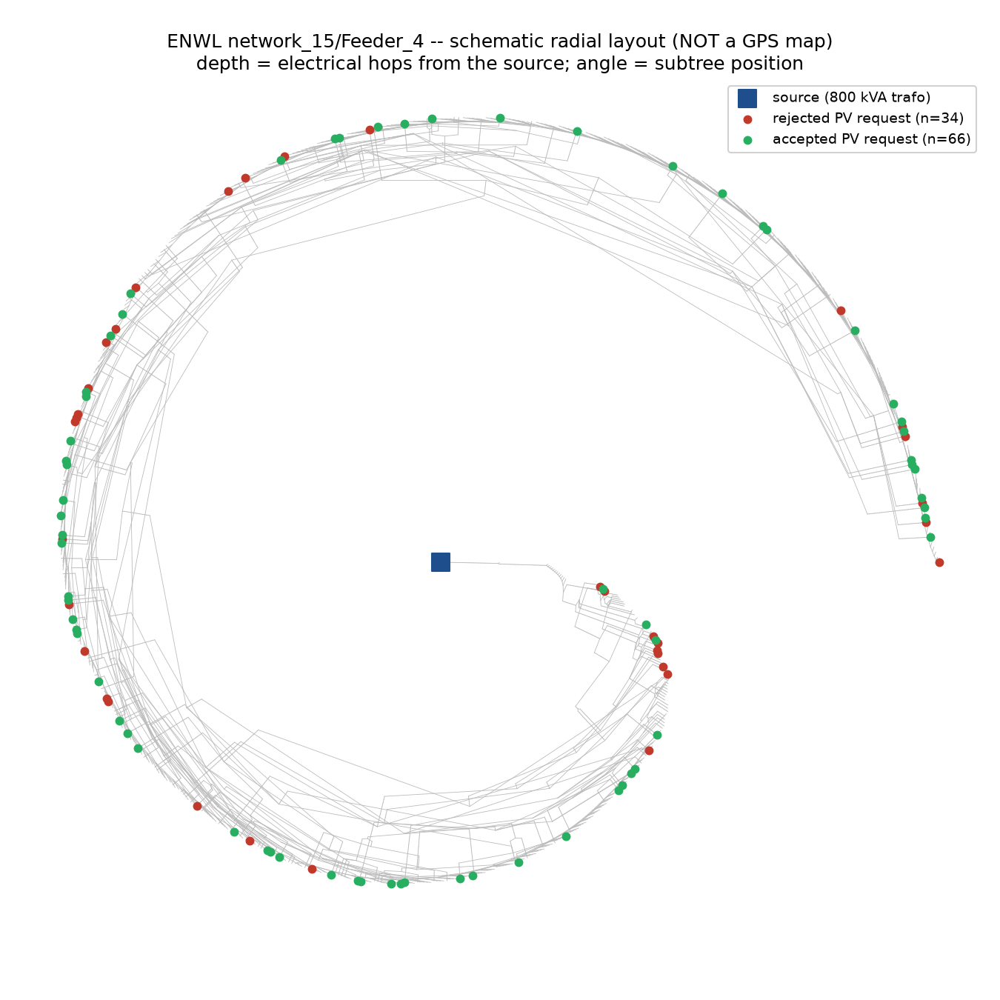

# M3 report: joint hosting-capacity allocation on a real feeder

**Network:** ENWL network_15/Feeder_4 -- real UK LV distribution feeder, 4769 buses, 138 house loads, 800 kVA transformer, radial (no loops).
**Candidate pool:** 100 rooftop-PV export requests (3-10 kWp each), seeded sample of real house buses.

## Ranked accept-set (NSGA-II best feasible result, largest request first)

| rank | request | bus | size (kW) |
|---:|:---|---:|---:|
| 1 | pv95 | 4497 | 3.1 |
| 2 | pv50 | 2453 | 3.3 |
| 3 | pv78 | 1134 | 3.4 |
| 4 | pv23 | 4739 | 3.6 |
| 5 | pv1 | 4139 | 3.6 |
| 6 | pv60 | 1330 | 3.7 |
| 7 | pv30 | 3297 | 3.8 |
| 8 | pv54 | 3900 | 3.9 |
| 9 | pv85 | 3214 | 4.2 |
| 10 | pv65 | 2954 | 4.3 |
| 11 | pv70 | 2853 | 4.4 |
| 12 | pv55 | 2810 | 4.5 |
| 13 | pv31 | 2111 | 4.5 |
| 14 | pv62 | 1565 | 4.5 |
| 15 | pv28 | 3453 | 4.7 |
| 16 | pv82 | 4759 | 4.8 |
| 17 | pv93 | 959 | 4.8 |
| 18 | pv61 | 3077 | 4.8 |
| 19 | pv11 | 2846 | 4.9 |
| 20 | pv90 | 4404 | 5.2 |
| 21 | pv33 | 3034 | 5.3 |
| 22 | pv64 | 4264 | 5.5 |
| 23 | pv91 | 1122 | 5.5 |
| 24 | pv71 | 2773 | 5.5 |
| 25 | pv48 | 188 | 5.6 |
| 26 | pv47 | 4724 | 5.7 |
| 27 | pv87 | 3161 | 5.9 |
| 28 | pv59 | 538 | 6.0 |
| 29 | pv84 | 4059 | 6.1 |
| 30 | pv18 | 3983 | 6.2 |
| 31 | pv86 | 3124 | 6.3 |
| 32 | pv25 | 1074 | 6.4 |
| 33 | pv66 | 2586 | 6.5 |
| 34 | pv89 | 2526 | 6.6 |
| 35 | pv41 | 3016 | 6.7 |
| 36 | pv8 | 4691 | 6.8 |
| 37 | pv94 | 3981 | 6.9 |
| 38 | pv88 | 448 | 7.0 |
| 39 | pv45 | 1780 | 7.2 |
| 40 | pv24 | 4748 | 7.3 |
| 41 | pv26 | 2034 | 7.4 |
| 42 | pv44 | 4751 | 7.4 |
| 43 | pv63 | 1595 | 7.5 |
| 44 | pv19 | 1740 | 7.6 |
| 45 | pv76 | 4721 | 7.7 |
| 46 | pv79 | 2490 | 7.7 |
| 47 | pv42 | 2770 | 7.8 |
| 48 | pv37 | 2038 | 7.9 |
| 49 | pv96 | 4491 | 8.2 |
| 50 | pv22 | 3342 | 8.6 |
| 51 | pv56 | 4068 | 8.6 |
| 52 | pv12 | 1071 | 8.7 |
| 53 | pv34 | 4232 | 8.7 |
| 54 | pv73 | 2033 | 8.9 |
| 55 | pv5 | 4710 | 8.9 |
| 56 | pv27 | 4637 | 8.9 |
| 57 | pv80 | 1864 | 8.9 |
| 58 | pv13 | 1909 | 8.9 |
| 59 | pv14 | 4711 | 9.3 |
| 60 | pv40 | 1471 | 9.4 |
| 61 | pv21 | 2953 | 9.4 |
| 62 | pv7 | 3168 | 9.5 |
| 63 | pv4 | 4735 | 9.5 |
| 64 | pv57 | 1720 | 9.6 |
| 65 | pv77 | 1865 | 9.8 |
| 66 | pv20 | 4521 | 10.0 |

**66/100 requests accepted, 433.6 kW accommodated, vmax=1.0520 pu, max line loading=100.0%, max trafo loading=36.0%, reinforcement cost=0.000 (0 = fully feasible).**

## Why this subset

- **Greedy queue-order baseline** (status-quo serial process, accept in arrival order until the first violation): 64/100 accepted, 432.3 kW, vmax=1.0489 pu, cost=0.000.
- **NSGA-II joint search** finds a fully feasible subset accommodating +1.2 kW more than the serial baseline, at equal or lower reinforcement cost.
- **M1 'dominates baseline' bar:** MET on this network/seed.
- **Binding constraint: THERMAL (line/transformer loading)** -- vmax 1.0520 pu (52% of the voltage headroom from baseline to the 1.10 pu limit used), max line loading 100.0% (100% of the thermal headroom to 100% used), transformer at 36.0% of its 800 kVA rating. Unlike EULV's M2 result (over-voltage-limited, matching Sandia's 72%-of-feeders pattern), *this* accept-set on *this* seed's request pool is thermally limited on a **line**, not voltage -- a genuine point of difference from EULV, reported as found rather than smoothed over (not re-checked across seeds here, unlike M2's robustness check -- a single seed is the M3 bar, not a claim that this feeder is always thermally-limited).
- The accepted set is not simply 'the N smallest requests' or 'the first N in the queue' -- it is whichever combination of buses avoids concentrating load on the same constrained branch, the same joint-packing effect experiments 24/25 demonstrated on EULV (there, spreading voltage rise; here, spreading line loading), now shown on a real feeder 5x the size.

## Map

Schematic radial-tree diagram, not a GPS map -- this ENWL corpus ships no bus coordinates (see this file's module docstring). Depth = electrical hops from the source transformer; green = accepted, red = rejected.
